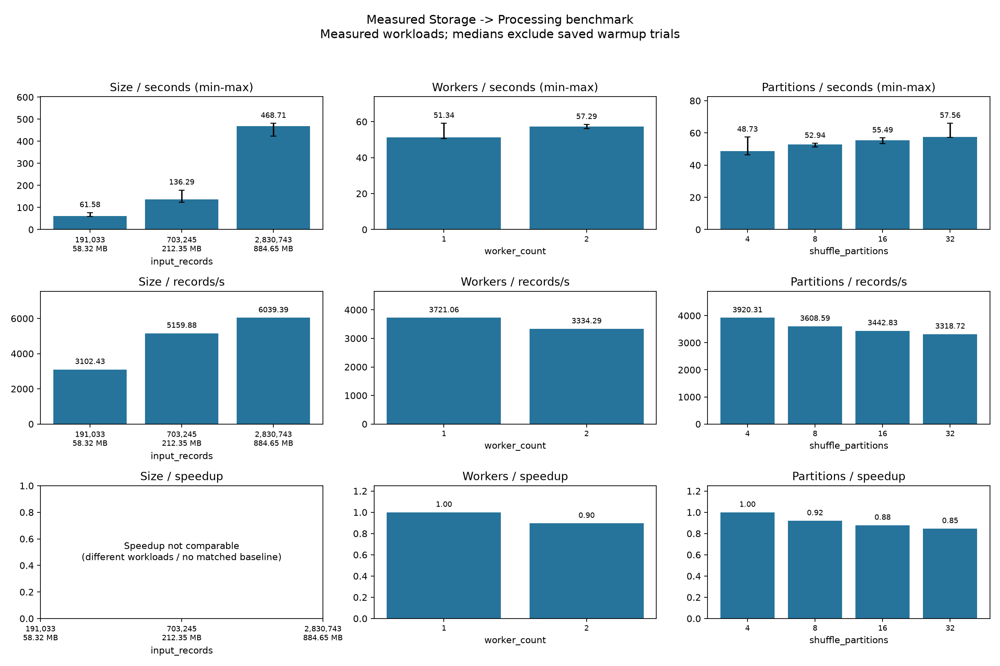

# Benchmark Velocity trên 8 CSV CICIDS2017 thật

Ngày thực hiện: 10/11/2026, Asia/Bangkok. Experiment ID: `real-20261110-141211`.
Commit pipeline: `981665e5a1d306761432828734f6dd16804093ec`.

## Kết quả kiểm tra nguồn

Thư mục `79rows/` chứa đủ 8 CSV, tổng **884.645.759 byte, 2.830.743 flow**.
Header từng file khớp chính xác contract 79 cột; tất cả dòng có 79 trường, không
có lỗi cú pháp CSV hoặc giải mã UTF-8. SHA-256 cả 8 file khớp hồ sơ nguồn của repo.
Checksum được kiểm tra lại sau benchmark và không thay đổi. Đây là CSV flow
thật của bộ dữ liệu CICIDS2017, không nhân bản synthetic. Không đo số packet PCAP.

Chi tiết: [source-audit.json](source-audit.json), [source-files.csv](source-files.csv),
[source-integrity-after.json](source-integrity-after.json).

## Cấu hình và phương pháp

- Windows 10 Pro build 19045; Intel i5-9400, 6 cores/6 logical processors, khoảng
  20 GiB RAM vật lý. Xem [host-machine.json](host-machine.json).
- Docker Engine 29.9.3, Linux/WSL2, 6 CPU và 10.406.920.192 byte RAM cấp cho Docker.
  Kernel `6.18.40.1-microsoft-standard-WSL2`.
- Spark 3.5.0, Python container 3.8.10, Java 11.0.20.1; driver heap tối đa 1 GiB.
- Mỗi worker 2 cores/2048 MiB; executor 2 cores/2g. Tăng worker từ 1 lên 2 tăng
  tài nguyên Spark cấp từ 2 cores/2 GiB lên 4 cores/4 GiB trên cùng máy vật lý.
- `DISK_ONLY`, cache batch 1000, AQE false. Giải phóng cache DataFrame sau mỗi trial;
  không flush cache OS/MinIO hoặc JVM/JIT. Một session Spark mỗi invocation.
- Mỗi invocation có 1 warmup riêng; mỗi cấu hình có 3 trial tính điểm. Thứ tự
  size/partition tăng ở vòng 1, đảo ở vòng 2, tăng ở vòng 3. Worker=1 đo trước worker=2.
- Timer gồm đọc S3A và SHA-256, transformation/validation và quality trước,
  cleaning/hậu kiểm/đối soát và quality sau, features, aggregation, ghi 5 Parquet
  Snappy và đọc lại count/schema/label. Không gồm startup Spark, upload input,
  xuất JSON/CSV cuối hoặc vẽ biểu đồ.
- Throughput từng trial = input flow / processing duration. Bảng dùng median của
  throughput từng trial; speedup dùng median duration baseline / median duration.

Môi trường, topology và tài nguyên app thực đo nằm trong [environment.json](environment.json)
và các JSON benchmark. Cgroup không đặt giới hạn riêng cho từng container; giới
hạn RAM của Docker VM vẫn có hiệu lực. Các quan sát `docker stats` trong lúc chạy
không phải phép lấy mẫu peak RAM có hệ thống.

## Workload thực dùng

| Workload size | File selection | Byte | Flow | Input partitions |
|---|---|---:|---:|---:|
| Nhỏ | Friday Morning | 58.316.725 | 191.033 | 2 |
| Vừa | Cả 3 file Friday | 212.346.752 | 703.245 | 8 |
| Đầy đủ | Cả 8 CSV | 884.645.759 | 2.830.743 | 30 |

Các mức là tập file nguyên gốc lồng nhau, không sao chép bản ghi để tạo tải.
Chúng có thành phần nhãn khác nhau và số input partitions khác nhau, nên phép đo
size mô tả mở rộng workload thực tế, không cô lập riêng ảnh hưởng số byte.
Không tính speedup giữa các workload khác nhau.

Nhóm worker và partition đều dùng **Friday Morning: 191.033 flow, 58.316.725 byte**.
Worker giữ p=4; partition giữ 2 worker. Số shuffle partitions 4/8/16/32 không phải
số partition của mọi stage hoặc mọi file output.

## Kết quả đầy đủ

Mỗi hàng có 3 trial; warmup không tính vào thống kê.

| Thí nghiệm | Cấu hình | Median (s) | Min–max (s) | Median flow/s | Speedup |
|---|---|---:|---:|---:|---:|
| Size, 2 workers, p=4 | 191.033 flow | 61,575 | 58,382–76,854 | 3.102,432 | N/A |
| Size, 2 workers, p=4 | 703.245 flow | 136,291 | 124,205–179,073 | 5.159,884 | N/A |
| Size, 2 workers, p=4 | 2.830.743 flow | 468,713 | 423,064–481,487 | 6.039,392 | N/A |
| Workers, 191k, p=4 | 1 worker | 51,338 | 50,474–59,102 | 3.721,061 | 1,000x |
| Workers, 191k, p=4 | 2 workers | 57,293 | 56,226–58,453 | 3.334,288 | 0,896x |
| Partitions, 191k, 2 workers | 4 | 48,729 | 46,398–57,414 | 3.920,308 | 1,000x |
| Partitions, 191k, 2 workers | 8 | 52,938 | 51,320–53,554 | 3.608,592 | 0,920x |
| Partitions, 191k, 2 workers | 16 | 55,487 | 53,344–56,873 | 3.442,829 | 0,878x |
| Partitions, 191k, 2 workers | 32 | 57,562 | 57,155–65,999 | 3.318,715 | 0,847x |

Warmup size/partition/worker-1/worker-2 lần lượt: **109,648 / 85,523 / 68,921 /
87,499 giây**. Không gộp các hàng có cùng cấu hình nhưng thuộc invocation/dimension
khác nhau để chọn kết quả đẹp.

[summary.csv](summary.csv) có 9 cấu hình; [runs.csv](runs.csv) có 27 trial tính điểm
và 4 warmup. JSON gốc: [size](size.json), [partitions](partitions.json),
[worker-1](workers-1.json), [worker-2](workers-2.json).

## Chất lượng và bằng chứng output

Ba trial trên toàn bộ 8 CSV đều đối soát:

`2.830.743 input = 2.830.628 VALID + 115 QUARANTINED + 0 REJECTED`.

Hậu kiểm PASS và cả 5 dataset Parquet đều read-back PASS. Features là biểu diễn bổ
sung của VALID; không cộng features vào phương trình bảo toàn flow.

Nguồn được upload bởi uploader có audit và chống ghi đè vào:
`s3a://bigdata-network/raw/cicids2017/`.

Output đợt đo nằm dưới `s3a://bigdata-network/benchmarks/real-20261110-141211/`,
với batch UUID riêng cho từng trial và các nhánh `cleaned`, `features`, `aggregates`,
`quarantine`, `rejected`, `report`, `performance`. Ví dụ batch toàn bộ 8 CSV lần 1:
`bench-35e6e8d8087d4972be6be0773efaa37d`.

Audit chỉ đọc đã tải lại marker cuối, quality JSON và performance JSON của cả
**31 batch**, kết quả **PASS**. Nó đối chiếu bằng chứng read-back **155 output
Parquet** đã thực hiện trong pipeline, không tự chạy lại 155 lần đọc Parquet.
Xem [minio-audit.json](minio-audit.json). [quality-example.json](quality-example.json)
chứa số liệu trước và sau làm sạch của **191.033 flow Friday Morning**, từ lượt
đo đầu tiên ở mức nhỏ trong thí nghiệm **size** (`bench-2881df4faa004204ba22d3e620fd800c`).
`size.json` và `runs.csv` xác định nhóm thí nghiệm theo batch ID. Số liệu toàn bộ
8 CSV nằm trong `size.json` và các quality report được dẫn từ đó.

## Phân tích và giới hạn

- Khi mở rộng từ 191k lên 2,83 triệu flow, throughput tăng từ khoảng 3.102 lên
  6.039 flow/s. Overhead cố định và số input partitions tăng là các khả năng góp
  phần; thành phần file/nhãn cũng thay đổi nên không quy mọi thay đổi cho size.
- Median từng stage trên ba trial đầy đủ: ingestion/checksum 89,571 s;
  transformation/validation/QA trước 125,108 s; cleaning/hậu kiểm/đối soát/QA sau
  175,247 s; features/aggregation 31,347 s; ghi/read-back 51,364 s. Median từng
  stage không cộng thành median tổng. Cleaning/hậu kiểm là stage lớn nhất trong
  nhóm số đo này; chưa tách CPU, shuffle và I/O thành nguyên nhân độc lập.
- Trên Friday Morning chỉ có 2 input partitions, hai worker có median chậm hơn
  một worker khoảng 11,6%, speedup 0,896x. Điều phối, I/O và tài nguyên dùng chung
  là các khả năng giải thích; phép đo không xác định riêng nguyên nhân và không
  suy rộng sang workload 2,83 triệu flow hoặc nhiều máy vật lý.
- p=4 có median thấp nhất trong bốn cấu hình đã đo trên Friday Morning. Ba lần
  lặp và khoảng biến thiên chưa chứng minh cấu hình tối ưu tổng quát hay khác biệt
  có ý nghĩa thống kê. Thanh sai số là min–max, không phải confidence interval.
- Có cache/JIT và hiệu ứng thứ tự. Worker=1 và worker=2 dùng session khác nhau;
  một warmup không loại hoàn toàn các hiệu ứng này.
- Đây là batch processing trên CSV flow. Chưa đo PCAP→flow, streaming, độ trễ
  cảnh báo hoặc suy luận/huấn luyện ML. `Flow Packets/s` của CSV không phải
  throughput Spark. Chưa thử workload lớn hơn 884,65 MB hay nhiều máy vật lý.

## Gián đoạn trước đợt này

Đợt `real-20261110-125212` bị Windows restart lúc 13:12:41; giữ nguyên JSON dở dang
và log trong thư mục đó. Đợt hiện tại chạy mới sau reboot với warmup và ba lần lặp
mới; không gộp số đo từ đợt gián đoạn. Xem [ghi nhận gián đoạn](../real-20261110-125212/INTERRUPTED.md).

## Tái lập và lưu trữ

[run_real.py](run_real.py) chỉ điều phối các CLI có sẵn, không thay pipeline.
[execution.jsonl](execution.jsonl) lưu lệnh chính xác, thời gian bắt đầu/kết thúc và
exit code. Các file `*.log` lưu raw output của từng lệnh; chúng được Git ignore,
nên cần sao lưu riêng cùng thư mục khi nộp minh chứng. Không chạy lại script vào
cùng experiment ID: nó từ chối ghi đè execution record và result/log cũ.

[Manifest SHA-256](artifact-sha256.csv) ghi checksum tại thời điểm lưu hồ sơ.
Checksum của `README.md` trong manifest ứng với bản trước khi sửa mô tả nguồn `quality-example.json`.

Sau đợt này: MinIO healthy, 2 worker ALIVE, không còn app Spark đang chạy. Không
thay mã `processing/`, `storage/`, `experiments/`, schema hoặc CSV nguồn.
