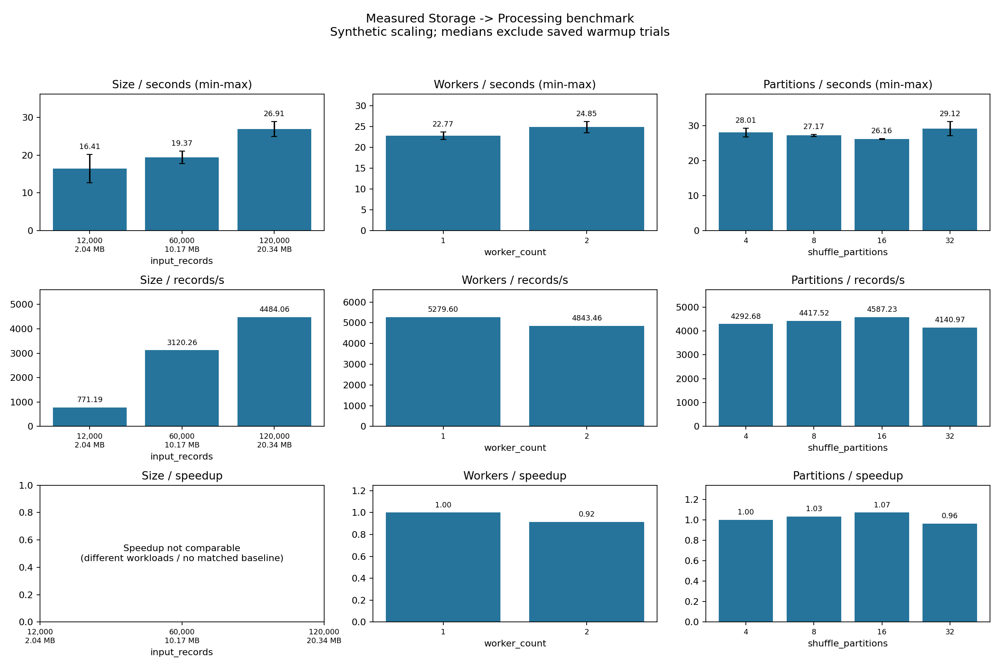

# Đọc và bảo vệ kết quả benchmark

Ngày phân tích 25/10/2026. Chỉ đọc code, JSON/CSV/log/biểu đồ đã có, không chạy lại
benchmark. Số đo chính dưới đây thuộc đợt **21/10/2026**; phép full-real read-only
thuộc 20/10 và có timing scope khác.

## 1. Câu hỏi của ba loại benchmark

| Benchmark | Giữ cố định trong thực nghiệm | Thay đổi | Trả lời được gì? |
|---|---|---|---|
| Size | 2 workers, 4 shuffle partitions, executor 2 cores/2g | 12k,60k,120k rows synthetic | Thời gian/throughput đổi thế nào khi lượng input tăng? |
| Workers | Cùng CSV 120k, hash/size, 4 shuffle partitions, tài nguyên mỗi worker/executor | 1 hoặc 2 workers | Full pipeline có nhanh hơn khi tăng tổng tài nguyên trên host này không? |
| Partitions | Cùng CSV 120k, 2 workers, resources | Shuffle partitions 4/8/16/32, AQE false | Chọn shuffle config nào có số đo tốt hơn cho workload này? |

Wrappers [size:5](../../experiments/benchmark_size.py#L5),
[workers:5](../../experiments/benchmark_workers.py#L5),
[partitions:5](../../experiments/benchmark_partitions.py#L5) đều gọi
[runner main:45](../../experiments/benchmark.py#L45).
Size không tự sinh input. Worker runner kiểm topology hiện tại, không tự thay Docker.
Partition runner set SQL config, không repartition input tại reader.

## 2. Input là synthetic scaling, không phải 120k flows mới thu thập

[scaled_payload:11](../../experiments/seed_scaling.py#L11) giữ một header và lặp 12
fixture rows 1.000/5.000/10.000 lần. Chỉ có 4/12 VALID, 6/12 QUARANTINED, 2/12 REJECTED.
Vì thế workload 120k có 40k/60k/20k ở ba output, khác xa tỷ lệ lỗi của dữ liệu thật.
Label và numeric values có độ lặp cao, ảnh hưởng shuffle, compression và cache.
Không coi đây là dữ liệu quan sát mới hoặc thước đo chất lượng phát hiện tấn công.

| Rows | Copies | Bytes đo được | MB (10^6 bytes) |
|---:|---:|---:|---:|
| 12.000 | 1.000 | 2.035.373 | 2,035 |
| 60.000 | 5.000 | 10.171.373 | 10,171 |
| 120.000 | 10.000 | 20.341.373 | 20,341 |

Nguồn: [scaling-manifest.json](../benchmarks/20261021/scaling-manifest.json),
bao gồm SHA-256 từng file và fixture. Không gán tên “1/3/5 GB” cho các workload này.

## 3. Môi trường và cách chạy đã ghi nhận

Spark 3.5.0, Python 3.8.10, Java 11.0.20.1; Docker Desktop Linux/WSL2 x86_64,
Docker thấy 16 logical CPUs và 8.149.880.832 bytes RAM. Driver heap tối đa 1 GiB.
Worker 2 cores/2048 MiB; executor 2 cores/2g. Hai workers cùng một host vật lý.
Các giới hạn cgroup v2 không đọc được nên artifact ghi null, không suy unlimited.
[docker-environment.json](../benchmarks/20261021/docker-environment.json),
environment và application_resources trong [workers-2.json](../benchmarks/20261021/workers-2.json).

DISK_ONLY, cache batch 1000, AQE=false. Mỗi invocation có một SparkSession và một
warmup riêng; hai lần lặp cho mỗi config được tính điểm. CLI default repeats=3,
nhưng **lệnh đã chạy override 2**, nên không nói đã có ba lần lặp.
[runner:52](../../experiments/benchmark.py#L52),
[commands.txt](../benchmarks/20261021/commands.txt).

Thứ tự scored trials:

```text
Size:       12k → 60k → 120k → 120k → 60k → 12k
Partitions: 4 → 8 → 16 → 32 → 32 → 16 → 8 → 4
Workers:    1,1 (session riêng) rồi 2,2 (session riêng)
```

Warmup đứng trước danh sách mỗi invocation. Thời gian warmup size/partition/1-worker/
2-worker lần lượt 41,154 / 46,885 / 39,893 / 44,007 giây. Có **18 scored trials +
4 warmup = 22 batch**; mỗi batch ghi/read-back năm output datasets. Source
[trial_order:26](../../experiments/benchmark.py#L26),
[warmup storage:149](../../experiments/benchmark.py#L149).

## 4. Processing time thực sự bao gồm gì?

Timer bắt đầu trong `run_pipeline` trước load contract/output preflight, dừng sau
năm write/read-back nếu bật output. Timestamps UTC cũng được lưu, nhưng duration
lấy `perf_counter`, không lấy chênh lệch clock wall để tránh clock adjustment.
[main:40](../../processing/main.py#L40), [main:109](../../processing/main.py#L109).

| Trong benchmark timer | Ngoài benchmark timer |
|---|---|
| Header/checksum/read/count nguồn | Seed/generate/upload input |
| Transform/classify, QA before | SparkSession/JVM startup |
| Clean/post validation/reconcile/QA after | Đổi topology Docker |
| Features/aggregation/count | Ghi quality JSON/CSV và performance JSON cuối |
| Năm Parquet write + schema/count/label read-back | Ghi final success marker, phần cleanup unpersist cuối |

`_STARTED`/preflight nằm trong overall duration nhưng không nằm trong stage timer
ingestion vì stage tick bắt đầu sau đó. Tổng stage durations có thể khác overall
duration một ít do overhead nằm ngoài stage ticks. Đây là full-pipeline duration
có correctness/quality cost, không phải “Spark tính sum thuần mất bao lâu”.
[main:59](../../processing/main.py#L59), [main:64](../../processing/main.py#L64),
[main:132](../../processing/main.py#L132), [main:154](../../processing/main.py#L154).

`--validate-only` có scope không ghi output; không so trực tiếp throughput của nó
với benchmark E2E. Report ghi `timing_scope`, không chỉ một con số seconds.

## 5. Throughput và speedup

```text
Throughput của trial i = input_records_i / processing_duration_seconds_i
Median time = median(times của các scored trials cùng config)
Median throughput = median(throughput từng scored trial)
Speedup(config) = median_time(baseline tương thích) / median_time(config)
```

Throughput lấy input cả ba status, không chỉ VALID; artifact còn có quality counts
để hiểu workload. Với hai lần đo, median là trung bình của hai số. Median throughput
không nhất thiết bằng input chia median time vì phép nghịch đảo không tuyến tính.
[main:113](../../processing/main.py#L113), [summarize:32](../../experiments/plot_results.py#L32).

Speedup >1 là nhanh hơn baseline; =1 ngang baseline; <1 chậm hơn. Workers baseline=1,
partitions baseline=4. Không tính fixed-workload speedup cho size khác nhau.
Summarizer chỉ ghép baseline khi checksum/bytes/config/environment/timing scope
phù hợp, ngoại trừ trục đang so. `warmup_runs` không được iterate trong summary.
[summarize:18](../../experiments/plot_results.py#L18),
[baseline matching:42](../../experiments/plot_results.py#L42).

Ví dụ công thức với số đo: `22,7664679845 / 24,8512794375 = 0,9161084862`.
Không lấy throughput ratio hoặc một trial đẹp nhất để thay median-time speedup.

## 6. Bảng size: từng lần và cách diễn giải

| Input rows / bytes | Lần 1 (s) | Lần 2 (s) | Median (s) | Median records/s |
|---|---:|---:|---:|---:|
| 12k / 2.035.373 | 20,148 | 12,675 | 16,411 | 771,185 |
| 60k / 10.171.373 | 21,016 | 17,722 | 19,369 | 3.120,259 |
| 120k / 20.341.373 | 28,913 | 24,908 | 26,910 | 4.484,063 |

Nguồn đo: [size.json](../benchmarks/20261021/size.json),
[summary.csv](../benchmarks/20261021/summary.csv).

Input tăng 10 lần, median time tăng khoảng 1,64 lần; median throughput tăng khoảng
5,81 lần. Phù hợp với khả năng workload nhỏ bị fixed overhead lấn át, nhưng không
chứng minh xử lý mọi input tuyến tính hoặc superlinear scalability. Warmup không
xóa hoàn toàn JIT/cache: ngay 12k hai lần vẫn lệch đáng kể, thứ tự và trạng thái
session là yếu tố cần công bố. Không gọi N/A speedup ở bảng size là thiếu dữ liệu;
đó là tránh so khác workload bằng một metric không thích hợp.

## 7. Bảng workers: kết quả âm là kết quả có giá trị

| Workers | App cores / executor memory | Lần 1 (s) | Lần 2 (s) | Median (s) | Median records/s | Speedup |
|---:|---|---:|---:|---:|---:|---:|
| 1 | 2 cores / 2048 MiB mỗi executor | 23,690 | 21,843 | 22,766 | 5.279,599 | 1,000× |
| 2 | 4 cores / 2048 MiB mỗi executor | 26,222 | 23,481 | 24,851 | 4.843,457 | 0,916× |

Nguồn: [workers-1.json](../benchmarks/20261021/workers-1.json),
[workers-2.json](../benchmarks/20261021/workers-2.json). Mỗi worker có 2 cores, nên tăng
số workers đồng thời tăng tổng resource request; không phải giữ nguyên tổng cores/RAM.

Hai workers có median time cao hơn khoảng 9,16%. Không hứa speedup chỉ từ số
workers. Một stage narrow chỉ có hai input partitions đã có thể dùng hết hai
slots ở một worker; stage shuffle khác có thể nhiều task hơn. Scheduling, network,
serialization, storage contention trên cùng host và cache là các giải thích khả dĩ.
Đây là giả thuyết, chưa được cô lập bằng profiling.

Phân tích stage timer hai topology (median, giây):

| Stage timer | 1 worker | 2 workers |
|---|---:|---:|
| ingestion + checksum | 2,600 | 2,605 |
| transform/validation/before QA | 5,068 | 6,815 |
| clean/post/reconciliation/after QA | 6,223 | 6,619 |
| features/aggregation | 2,085 | 1,916 |
| output write/read-back | 6,720 | 6,833 |

Tính lại từ `runs[*].performance.stage_duration_seconds` của hai JSON, không phải
CPU profiler. Quan sát: stage features/aggregate thấp hơn nhưng overall cao hơn;
không thể suy nguyên nhân duy nhất là network. Không trộn với kết quả p=4 thuộc
invocation partitions hoặc size để chọn thời gian nhanh hơn.

## 8. Bảng partitions: 16 chỉ tốt nhất trong phép đo này

| Shuffle config | Lần 1 (s) | Lần 2 (s) | Median (s) | Median records/s | Speedup so với 4 |
|---:|---:|---:|---:|---:|---:|
| 4 | 26,752 | 29,270 | 28,011 | 4.292,683 | 1,000× |
| 8 | 27,466 | 26,870 | 27,168 | 4.417,520 | 1,031× |
| 16 | 26,241 | 26,078 | 26,160 | 4.587,230 | 1,071× |
| 32 | 31,189 | 27,061 | 29,125 | 4.140,968 | 0,962× |

Nguồn: [partitions.json](../benchmarks/20261021/partitions.json).
16 thấp nhất trong bốn medians, hơn baseline khoảng 7,1% theo speedup. 32 chậm hơn
baseline. Mỗi partition thêm có scheduling/serialization/exchange overhead; partition
quá ít có thể thiếu parallelism hoặc lớn/skew. Hai repeats chưa đủ significance
test hay kết luận optimum tổng quát.

AQE tắt để tránh tự coalesce shuffle che biến config. Tuy vậy không phải mọi stage
đều có đúng config tasks: global aggregate có thể ít hơn, input/features vẫn 2
partitions thực tế, các branches/stages có kế hoạch riêng. Mặc định main thông thường
không tắt AQE ở config.py; không đánh đồng benchmark setting với mọi job.
[runner:125](../../experiments/benchmark.py#L125),
[main actual partitions:124](../../processing/main.py#L124).

## 9. Đọc biểu đồ



Ba cột là size/workers/partitions; hàng 1 thời gian, hàng 2 throughput, hàng 3
speedup. Cột thời gian thấp hơn là nhanh hơn; throughput/speedup cao hơn là tốt hơn
trong comparison phù hợp. Thanh sai số biểu diễn **min–max**, không phải confidence
interval. ô size/speedup không có cột vì workload khác nhau.
[chart:90](../../experiments/plot_results.py#L90).

Không so chiều cao bars ở các subplot khác thang y. PNG là kết quả của summary
thực nghiệm, không phải sơ đồ kiến trúc hay screenshot Spark UI. Dữ liệu từng
trial/warmup ở [runs.csv](../benchmarks/20261021/runs.csv).

## 10. Full-real result và nút thắt đã quan sát

8 CSV thật đã xử lý `VALIDATED_NO_OUTPUT` trên local mount: 315,380 s,
8.975,671 records/s; 884.645.759 bytes, 2.830.743 rows; 2.830.628 V/115 Q/0 R.
Mỗi executor 2g/2 cores, shuffle config 4, AQE true, input partitions 30.
[pipeline-eight-real.local.json](../evidence/local/pipeline-eight-real.local.json).

Timer ingestion/checksum 88,930 s, transform/validation/before QA 68,065 s,
clean/post/reconciliation/after QA 133,420 s, features/aggregate 24,947 s. Nhóm
clean/post/QA lớn nhất, khoảng 42,3% overall. Không gọi toàn 133,420 s là riêng
“cleaning”, cũng không quy cả ingestion cho network: nguồn là local mount.

Lịch sử 1g gặp OOM, 2g thành công được giữ trong [pipeline-validation.md](../reports/pipeline-validation.md).
Không đưa con số 8.975 records/s so với synthetic E2E 4.484 records/s để chứng minh
dữ liệu thật “nhanh gấp đôi”, vì khác source, trạng thái/cache, workload và write scope.

## 11. Công bằng và khả năng tái lập tới mức nào?

| Điểm tốt của phương pháp | Giới hạn phải nói |
|---|---|
| Cùng checksum/bytes trong fixed-workload comparisons | Input low entropy, đa số lỗi nhân tạo, cao nhất 20,34 MB |
| Cùng resources mỗi worker/executor, được Master xác nhận | Tổng resources tăng khi tăng worker; vẫn cùng máy vật lý |
| Có warmup riêng, repeats, thứ tự size/partition đảo ngược | Chỉ hai repeats, không randomized nhiều rounds; worker 1 luôn trước 2 |
| DataFrame caches được unpersist | OS/MinIO/JVM/JIT caches không flush; không có cold-start I/O benchmark riêng |
| Timer thống nhất, gồm read-back và QA | Không có mức CPU/GC/network/RSS/bytes profile để xác định causal bottleneck |
| Result FAILED bị từ chối summarize | COMPLETE JSON là artifact ứng dụng, không một proof tuyệt đối mọi invariant ngoài code |
| Có environment/commands/hash/log | pipeline_version hằng, image tags chưa pin digest; snapshots không chứng minh hiện trạng remote ngày 25/10 |

Source kiểm COMPLETE ở [plot:16](../../experiments/plot_results.py#L16), environment ở
[benchmark:33](../../experiments/benchmark.py#L33), phương pháp ở
[benchmark:114](../../experiments/benchmark.py#L114). Kết luận: có thể tái lập **quy trình**
và đối chiếu workload/config; không kỳ vọng lặp lại đúng từng mili-giây.

Tính điểm benchmark helpers dùng timing fixture như 2/4 giây để test công thức,
không phải số đo Spark; xem [test_benchmark:21](../../tests/test_benchmark.py#L21).

## 12. Ba kết quả nên trình bày nhất

1. **Bảo toàn và chất lượng trên bộ thật:** 2.830.743 = 2.830.628 + 115 + 0;
   NaN 1.358→0, Infinity 4.376→0, raw/label bảo toàn; ghi rõ read-only, không real output.
2. **Storage E2E có kiểm chứng:** 22 batch synthetic, mỗi batch năm Parquet read-back,
   JSON QA/performance/final marker; 36/36 tests PASS lịch sử và log digest khớp.
   [minio-audit](../benchmarks/20261021/minio-audit.json),
   [test-results](../benchmarks/20261021/test-results.json).
3. **Scaling không miễn phí:** worker speedup 0,916× và partition 16 thấp nhất trong
   bốn cấu hình; dùng điều đó giải thích workload nhỏ, partitions, overhead và giới hạn phép đo.

Không hứa các số đo này tự bảo đảm 9 điểm. Độ thuyết phục đến từ giải thích đúng
source, tách quan sát với giả thuyết và chỉ ra phần chưa kiểm chứng.
