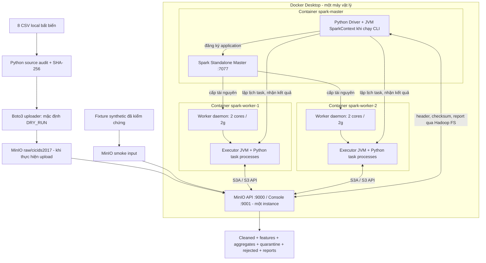

# Hiểu kiến trúc hệ thống Storage → Processing

Ngày đọc mã nguồn: **25/10/2026**. Đây là tài liệu giải thích từ source và artifact
đã có; không phải kết quả chạy lại pipeline ngày 25/10. Không sửa code, contract,
cấu hình hoặc dữ liệu khi lập bộ tài liệu này.

Lộ trình học: tài liệu này → [11 bước](pipeline-walkthrough.md) →
[theo dõi record và chất lượng](data-quality-explained.md) →
[Spark](spark-distributed-explained.md) → [code](code-walkthrough.md) →
[benchmark](benchmark-explained.md) → [ôn vấn đáp](../defense/defense-questions.md) →
[demo](../defense/defense-demo-script.md).

## 1. Hệ thống giải quyết việc gì?

Ta có các dòng mô tả **network flow**, tức thống kê của một luồng mạng đã được
trích xuất từ trước. CSV có thể chứa dữ liệu sai kiểu, Infinity, số âm, sentinel,
header trùng và nhãn khó đọc. Hệ thống đưa dữ liệu ấy về schema rõ ràng, phân loại
chất lượng, xử lý lỗi được phép, tính thống kê, rồi lưu output có thể kiểm chứng.
Đầu ra phục vụ đọc và phân tích tiếp; `VALID` là trạng thái chất lượng dữ liệu,
không phải kết luận lưu lượng an toàn. Nguồn quy định: [Contract:26](../../data/schemas/feature_dictionary.md#L26),
[validate_flows:138](../../processing/validation.py#L138).

Điểm vào xử lý chính là `python -m processing.main`, gọi `main()` rồi
`run_pipeline()`. Tên repository có PCAP nhưng `extraction/extract_flow.py` và
`extraction/utils.py` hiện là placeholder, không nằm trong đường chạy này.
Xem [main:162](../../processing/main.py#L162), [run_pipeline:34](../../processing/main.py#L34).

## 2. Vì sao thuộc Big Data? Có nhất thiết cần Spark không?

Hai đặc trưng thể hiện được là **Volume** và **Veracity**. Bộ thật có 2.830.743
flows, 884.645.759 bytes; lỗi chất lượng và yêu cầu truy vết xuất hiện ở nhiều file.
Đây là workload học tập gần 0,885 GB thập phân, chưa phải bằng chứng vận hành ở
quy mô TB. Số liệu được lưu trong [report thật local](../evidence/local/pipeline-eight-real.local.json),
các kết luận trong [hồ sơ kiểm chứng](../reports/pipeline-validation.md).

Spark phù hợp với việc chia dữ liệu thành phần, chạy các phép biến đổi và tổng hợp
trên executors, và mở rộng khi input tăng. Tuy nhiên, không thể nói Python hoặc
Pandas chắc chắn không xử lý nổi bộ dữ liệu này: chưa có benchmark đối chứng.
Giá trị đồ án là thực hiện và kiểm chứng cách xử lý phân tán, kiểm soát dữ liệu và
storage, thay vì chỉ khẳng định dữ liệu “rất lớn”. Đường đọc phân tán nằm ở
[read_raw_flows:94](../../processing/ingestion.py#L94), tổng hợp ở
[aggregate_flows:30](../../processing/features.py#L30).

Không có streaming: code dùng input hữu hạn, đếm bản ghi, ghi batch có UUID;
không có `readStream`, `writeStream` hoặc checkpoint streaming. Bằng chứng là
[run_pipeline:65](../../processing/main.py#L65) và [output_plan:43](../../processing/output.py#L43).

## 3. Kiến trúc đang triển khai



Sơ đồ dựa trên [Compose:37](../../docker/docker-compose.yml#L37),
[cấu hình Spark:126](../../processing/config.py#L126),
[ingestion:69](../../processing/ingestion.py#L69), [ghi output:98](../../processing/main.py#L98).
Driver nằm trong container master **vì lệnh CLI được exec ở đó**; master daemon
và driver là hai vai trò/process khác nhau. Chạy CLI ở nơi khác sẽ đặt driver ở
nơi đó. `local[2]` sẽ dùng chế độ local, dù process có nằm trong container Spark.

Hai PNG placeholder đã được loại bỏ khi dọn tài liệu. Mermaid này mô tả source
hiện tại; không dùng hình rỗng làm bằng chứng kiến trúc.

## 4. Mỗi thành phần làm gì?

| Thành phần | Vai trò trong dự án | Bằng chứng |
|---|---|---|
| Docker Compose | Khởi tạo service, mạng nội bộ, volume và environment nhất quán | [Compose:1](../../docker/docker-compose.yml#L1) |
| Master | Quản lý tài nguyên Spark Standalone; không trực tiếp chạy mọi phép ETL | [Compose:42](../../docker/docker-compose.yml#L42) |
| Worker | Daemon cung cấp tài nguyên, khởi chạy executor cho application | [Compose:52](../../docker/docker-compose.yml#L52) |
| Driver | Điều phối `run_pipeline`, dựng plan và gọi action | [main:34](../../processing/main.py#L34) |
| Executor | Thực thi task và lưu các partition được persist; được yêu cầu cores/memory | [config:134](../../processing/config.py#L134) |
| MinIO | Giữ object đầu vào/đầu ra; không tự cast/clean/aggregate | [Compose:18](../../docker/docker-compose.yml#L18), [main:65](../../processing/main.py#L65) |
| S3A | Hadoop filesystem client chuyển URI `s3a://` thành thao tác object storage | [config:139](../../processing/config.py#L139) |
| Boto3 | Python SDK dùng bởi uploader và seeder, khác đường I/O Spark | [upload main:63](../../storage/upload_minio.py#L63) |

MinIO tách storage khỏi vòng đời process Spark. Executors cùng truy cập một bucket,
không phải chép file vào riêng từng worker. Volume `minio_data` giữ dữ liệu của
MinIO; mount repository `/workspace:ro` giúp mọi container đọc được cùng source
và CSV local. Đây là một MinIO instance trên một volume, không chứng minh storage
HA hay cluster nhiều máy. Xem [Compose:5](../../docker/docker-compose.yml#L5),
[Compose:28](../../docker/docker-compose.yml#L28).

## 5. Hai đường giao tiếp khác nhau

```text
Upload: Python → Boto3 → S3 API/HTTP → MinIO :9000
Spark:  PySpark → JVM/Hadoop FileSystem → S3A → AWS Java SDK → MinIO :9000
```

S3 API là giao diện dịch vụ; S3A là thư viện client triển khai giao diện filesystem
cho Hadoop. Chọn filesystem bằng scheme URI; `s3a://bigdata-network/...` chứa bucket
và key, còn endpoint lấy từ cấu hình. Bên trong Docker dùng `http://minio:9000`;
`localhost` trong worker chỉ chính worker ấy. Cấu hình path-style được bật. Xem
[config:137](../../processing/config.py#L137). Mô tả S3A được đối chiếu với
[Hadoop AWS 3.3.4](https://hadoop.apache.org/docs/r3.3.4/hadoop-aws/tools/hadoop-aws/index.html).

Spark image chứa `hadoop-aws:3.3.4` và AWS SDK bundle `1.12.262`; Compose để
`SPARK_PACKAGES` rỗng vì JAR đã cài sẵn, không phải thiếu connector. Xem
[Dockerfile Spark:4](../../docker/spark/Dockerfile#L4), [Compose:14](../../docker/docker-compose.yml#L14).
Credentials lấy từ environment; bộ tài liệu này không chứa nội dung `.env`.

## 6. Data Contract là “đề bài máy có thể kiểm tra” tới mức nào?

Markdown quy định ý nghĩa, đơn vị, chính sách. JSON ghi ánh xạ vị trí của 79 cột,
tên canonical, kiểu raw String và kiểu đích 22 trường. JSON **không phải** native
`StructType` JSON. `load_contract()` kiểm tra cấu trúc/version/field count, còn
`raw_schema()` dựng schema Spark; chính sách range/rate vẫn được viết trong Python,
không phải mọi câu trong Markdown đều được tự động thực thi.
Xem [config:23](../../processing/config.py#L23), [config:45](../../processing/config.py#L45),
[validate_flows:138](../../processing/validation.py#L138).

## 7. Storage: bucket, prefix, schema, đọc lại

Ví dụ `s3a://bigdata-network/cleaned/flows/<batch>/part-....parquet`:
`bigdata-network` là bucket, phần sau là object key; `cleaned/flows/<batch>/` là
prefix, không phải thư mục POSIX có transaction rename. Prefix mặc định khai báo
ở [config:67](../../processing/config.py#L67). Output synthetic đã đo dùng prefix
khác ở [quality-example.json](../benchmarks/20261021/quality-example.json).

| CSV nguồn | Parquet output |
|---|---|
| Text theo hàng, phải parse/cast | Dữ liệu có schema, lưu theo cột |
| 79 trường raw String sau ingestion | Cleaned đúng 22 core + 12 metadata; features thêm 4 cột |
| Giữ bất biến làm bằng chứng | Ghi theo batch mới, nén Snappy |
| Có lỗi text/width | Được đọc lại kiểm tra dtype/count; flow còn kiểm tra label/source/status |

Code thực hiện tại [clean:53](../../processing/clean.py#L53),
[add_features:22](../../processing/features.py#L22),
[write_verified_parquet:79](../../processing/output.py#L79).

Columnar storage gom dữ liệu cùng cột thành các column chunks trong row groups;
đọc vài cột có thể giảm I/O (**column pruning**). Predicate pushdown có thể tận
dụng metadata để bỏ qua phần không cần đọc, nhưng không bảo đảm mọi filter loại
được mọi row group. Snappy là codec nén, không phải schema hay partitioning. Dự án
đã kiểm tra codec trong footer ở [test_pipeline:57](../../tests/test_pipeline.py#L57);
chưa có benchmark chứng minh pruning/pushdown giảm bao nhiêu I/O. Tham khảo
[Parquet overview](https://parquet.apache.org/docs/overview/) và
[Spark 3.5.0 Parquet](https://raw.githubusercontent.com/apache/spark/v3.5.0/docs/sql-data-sources-parquet.md).

**Partitioning thực tế:** UUID batch trong đường dẫn, không có `partitionBy(label)`
hay `partitionBy(source_file)`, không `repartition()`/DataFrame `coalesce()` trước
write. Số file phụ thuộc partition của từng frame/stage, output rỗng và committer;
không suy số file từ `shuffle_partitions`. Chưa có compaction/small-file management.
Contract mục 10 là khuyến nghị; writer hiện tại ở [output:81](../../processing/output.py#L81).

Chạy lại cùng batch bị từ chối khi output đã tồn tại; batch UUID mới tạo bộ output
mới cho cùng input. Điều này bảo vệ output cũ, **không** tạo exactly-once ingest hoặc
deduplicate xuyên các batch. Consumer đọc nhiều batch có thể đếm lặp nếu tự union.
Xem [output_plan:55](../../processing/output.py#L55), [preflight:63](../../processing/output.py#L63).

## 8. Đã chứng minh được những gì?

| Mức bằng chứng | Trạng thái đọc được từ artifact |
|---|---|
| Tests | 36/36 PASS ngày 21/10, log SHA-256 khớp [test-results.json](../benchmarks/20261021/test-results.json) khi đọc lại ngày 25/10 |
| MinIO end-to-end | 22 batch synthetic gồm 18 trial + 4 warmup; audit báo 110 **output datasets**, không phải 110 physical part-files |
| 8 CSV thật | 2.830.743 input = 2.830.628 VALID + 115 QUARANTINED + 0 REJECTED; `VALIDATED_NO_OUTPUT`, input local mount read-only |
| Storage thật | Chưa có bằng chứng ghi output của cả 8 CSV thật lên MinIO |
| Distributed allocation | Benchmark ghi Master URL, topology ALIVE và app 2/4 cores; chưa lưu đầy đủ task-per-executor timeline |
| Benchmark | Size/worker/partition đã có số đo; không có baseline Pandas, tải GB, nhiều máy hoặc test HA |

Nguồn: [minio-audit.json](../benchmarks/20261021/minio-audit.json),
[workers-2.json](../benchmarks/20261021/workers-2.json),
[pipeline-eight-real.local.json](../evidence/local/pipeline-eight-real.local.json).
Artifact lịch sử không chứng minh service hiện đang chạy; đợt giải thích này không
khởi động Docker hoặc đọc lại remote object.

## 9. Đối chiếu rubric được người dùng cung cấp

Không tìm thấy PDF/DOCX đề giảng viên hay rubric gốc trong workspace; bản nháp rỗng
đã được loại bỏ. Sáu trọng số dưới đây lấy từ yêu cầu người dùng, chưa xác thực với
tài liệu lớp. Đây là đánh giá khoảng thiếu, **không phải điểm dự đoán**.

| Tiêu chí | Đã đáp ứng và bằng chứng | Thiếu/chưa kiểm chứng, rủi ro hỏi | Cải thiện nên chuẩn bị |
|---|---|---|---|
| Hoàn thành hệ thống — 2,5 | Toàn đường xử lý và E2E synthetic, [main:34](../../processing/main.py#L34), audit 22 batch | Full real E2E MinIO chưa có; dễ nói quá phạm vi | Trình bày rõ hai loại bằng chứng; thực nghiệm real output chỉ khi được cho phép |
| Thiết kế kỹ thuật — 2,0 | Contract, strict parser, typed schema, flags, multiset reconciliation, read-back | Contract còn điểm mô tả lệch code; thiếu transaction/compaction | Nắm [review](code-walkthrough.md); giải thích trade-off thay vì khẳng định hoàn hảo |
| Thực nghiệm — 2,0 | Tests, QA, log, 18 trial, 4 warmup, CSV/PNG | Chưa có saved task timeline/screenshot; hai ảnh kiến trúc rỗng | Dùng Mermaid trong tài liệu này, chuẩn bị Spark UI theo [demo](../defense/defense-demo-script.md) |
| Big Data/mở rộng — 1,5 | Volume + Veracity, executor resource evidence, worker comparisons | Một máy, 20 MB synthetic load; chưa chứng minh speedup khi scale lớn | Phân biệt scale-out tài nguyên và speedup; không gọi đây là cluster đa máy |
| Phân tích/thảo luận — 1,0 | Worker speedup 0,916×, phân tích min–max và QA | Chưa xác định nguyên nhân bottleneck bằng profiling | Trình bày quan sát và giả thuyết tách biệt; học [benchmark](benchmark-explained.md) |
| Báo cáo/tái lập — 1,0 | Commands, manifest/hash, JSON/CSV, hướng dẫn | Báo cáo học phần hoàn chỉnh/phân công chưa có trong bản draft | Tổng hợp bài nộp theo rubric lớp; luyện 3/7 phút và demo |

Ba năng lực đáng tập trung để bảo vệ tốt: tự truy vết một row; giải thích vì sao
phân tán chưa chắc nhanh; mở đúng artifact và chứng minh count/schema/marker.
