# Pipeline: 11 bước từ nguồn tới bằng chứng thực nghiệm

Đọc source ngày 25/10/2026. Các lệnh dưới đây dùng để học/tái lập sau này, **không
được thực thi khi soạn tài liệu**. Số đo là artifact ngày 20–21/10. Đường batch chính
được điều phối bởi [run_pipeline — main.py:34](../processing/main.py#L34).

```mermaid
flowchart LR
  A[Audit local] --> B[Upload được chủ động thực hiện]
  B --> C[MinIO CSV]
  C --> D[Smoke / Ingestion]
  D --> E[Transform]
  E --> F[Validate]
  F --> G[Clean]
  G --> H[Post-validate + reconcile]
  H --> I[Features + Aggregates]
  I --> J[Parquet + read-back]
  J --> K[Quality / Performance / final marker]
  K --> L[Benchmark analysis]
```

Audit/upload/smoke là entry point chuẩn bị/kiểm chứng riêng. `main` không tự audit
local rồi upload 8 CSV. Benchmark gọi lại toàn `run_pipeline`, không chỉ đo một
phép tổng hợp. Xem [main:65](../processing/main.py#L65),
[benchmark:130](../experiments/benchmark.py#L130).

## 1. Source Audit (Data Profiling)

1. **Mục đích:** biết dữ liệu đang có gì trước khi upload và trước khi chọn chính
   sách; đây là kiểm toán nguồn, chưa phải kết quả Spark xử lý.
2. **Input:** 8 CSV local theo tên trong contract, header 79 trường; đọc bytes để
   hash giữ đúng nội dung nguồn.
3. **Processing:** từng file được stream theo physical line; kiểm header/width,
   giải mã UTF-8, so hai header trùng, thống kê kiểu/range/lỗi và nhãn. `ProcessPoolExecutor`
   chia file cho process local; không phải Spark executors.
4. **Output:** JSON có bytes/hash/count, thống kê 79 field và `policy_preview`.
   `structurally_ready_for_upload` kiểm header và malformed, không yêu cầu mọi value sạch.
5. **Source Code:** [audit_file:17](../processing/audit_source.py#L17),
   [main:146](../processing/audit_source.py#L146), tạo report ở
   [audit:167](../processing/audit_source.py#L167).
6. **Example:** fixture 12 dòng cho preview 4 VALID, 6 QUARANTINED, 2 REJECTED;
   [test_audit:11](../tests/test_audit.py#L11) xác nhận cả SHA và vị trí 35/56.
   Không nhầm preview Python với output Spark.
7. **Error Handling:** sai tập tên file dừng CLI; CSV syntax/width lỗi được đếm.
   UTF-8 lỗi được đếm và decode replacement cho thống kê; bytes nguồn không sửa.
   Header mismatch thể hiện trong report, khiến structural-ready false.
8. **Verification:** đối chiếu header/hash/record counts; xem
   [source-audit-report.md](source-audit-report.md), không chạy lại audit 884 MB khi chỉ học.
9. **Technical Rationale:** stream giảm RAM, audit 79 cột nhìn được cả ngoài 22 core;
   SHA phục vụ lineage và chống upload nhầm phiên bản file, không chứng minh ngữ nghĩa dữ liệu đúng.
10. **Defense Questions:**
    - Audit khác validation? Audit mô tả toàn file và preview; validation Spark gán trạng thái từng row theo policy.
    - “Ready upload” nghĩa là dữ liệu hoàn toàn đúng? Không, chỉ qua structural checks; lỗi giá trị được giữ cho processing.
    - `--workers 2` ở audit là hai Spark Workers? Không, là hai process Python trên host chạy audit.

## 2. Data Upload

1. **Mục đích:** đưa đúng phiên bản raw đã audit vào object storage để Spark dùng chung.
2. **Input:** 8 CSV local, JSON audit, config bucket/endpoint từ environment.
3. **Processing:** kiểm contract/schema hashes, đủ đúng 8 tên, bytes/SHA từng file;
   dựng key `raw/cicids2017/<filename>`. Chỉ khi `--execute` mới dùng Boto3,
   `HEAD` bucket/object, upload các key chưa có, rồi kiểm metadata/length.
4. **Output:** mặc định là kế hoạch `DRY_RUN`; khi execute thành công là object raw.
5. **Source Code:** [prepare_upload:23](../storage/upload_minio.py#L23),
   [main:49](../storage/upload_minio.py#L49), [upload loop:81](../storage/upload_minio.py#L81).
   `storage/minio_client.py` chưa có triển khai.
6. **Example:** Tuesday được ánh xạ thành key
   `raw/cicids2017/Tuesday-WorkingHours.pcap_ISCX.csv`, SHA lấy từ audit.
   [dry-run artifact](source-integrity-20261021.local.json) ghi kế hoạch, không chứng minh remote object tồn tại.
7. **Error Handling:** khác hash/size/contract dừng; object có metadata khác bị từ chối
   overwrite; lỗi mạng/SDK propagate. Cần single writer: preflight rồi upload không phải atomic create-if-absent.
8. **Verification:** dry-run chứng minh input không đổi; verification uploader kiểm
   length + metadata tự ghi, không tải lại bytes để hash. Ingestion Spark sẽ hash nội dung remote khi được chạy.
9. **Technical Rationale:** Boto3 phù hợp transfer file/control-plane; Spark không cần
   làm uploader. Metadata hash không nên được coi là checksum độc lập của remote bytes.
10. **Defense Questions:**
    - Lệnh không `--execute` có upload không? Không; return trước import Boto3 và kết nối mạng.
    - Remote hash metadata giống có bảo đảm bytes đúng? Chưa; metadata có thể không phản ánh bytes, cần content checksum độc lập.
    - Upload 8 file có all-or-nothing không? Không; lỗi giữa chừng có thể để lại một số object đã upload, raw không bị tự rollback.

## 3. Connectivity / Smoke Test

1. **Mục đích:** kiểm đường Spark ↔ S3A ↔ MinIO bằng dữ liệu biết trước, phân biệt
   lỗi credentials, endpoint, classpath với lỗi nghiệp vụ.
2. **Input:** `INPUT_PATH` phải `s3a://`; có thể trỏ fixture synthetic 12 dòng.
3. **Processing:** tạo SparkSession, `read_raw_flows`, persist raw, count per file,
   chạy `clean_flows`, so tổng counts và lấy schema.
4. **Output:** `check_minio` in JSON, tùy chọn ghi local report; không ghi Parquet.
   `tests.smoke_pipeline --execute` là E2E khác, có seed và ghi batch smoke riêng.
5. **Source Code:** [check_minio main:15](../processing/check_minio.py#L15),
   [smoke main:14](../tests/smoke_pipeline.py#L14), [seed main:9](../tests/seed_minio.py#L9).
6. **Example:** fixture kỳ vọng `12 = 4 + 6 + 2`, kiểm ở
   [smoke:34](../tests/smoke_pipeline.py#L34). Report lịch sử:
   [pipeline-smoke-final.local.json](pipeline-smoke-final.local.json).
7. **Error Handling:** không S3A bị parser error; header/connection lỗi propagate;
   chỉ header không có data trả lỗi. `finally` unpersist/stop Spark.
8. **Verification:** xem `status`, app ID, schema và counts. Smoke đọc thành công
   chưa đủ khẳng định storage output đúng; cần E2E/read-back riêng.
9. **Technical Rationale:** workload nhỏ khoanh vùng hạ tầng nhanh. `check_minio`
   vẫn dùng MEMORY_AND_DISK cố định, nên không nên gọi nó “nhỏ” nếu input mặc định trỏ cả 8 file.
10. **Defense Questions:**
    - MinIO healthy có chứng minh Spark truy cập được? Không, healthcheck không kiểm connector/credentials của Spark.
    - `--skip-checksum` bỏ gì? Bỏ lượt đọc tính SHA, không phải bỏ toàn ingestion; lineage audit lúc đó không đầy đủ.
    - Smoke và E2E khác nhau? `check_minio` chỉ đọc/clean; `smoke_pipeline` thêm output, report và final marker.

## 4. Data Ingestion

1. **Mục đích:** parse đúng vị trí, giữ cả dòng hỏng và bằng chứng, tránh mất row im lặng.
2. **Input:** URI/glob `.csv` qua Hadoop FS; 79 header theo schema JSON, có hai
   `Fwd Header Length`. Raw DataFrame có 79 String fields + 5 cột evidence/source.
3. **Processing:** driver list file, đọc/so mọi header, SHA-256 từng file bằng JVM
   stream. Sau đó `textFile().mapPartitionsWithIndex()` parse bằng Python CSV strict;
   chỉ bỏ header của partition 0 từng file; union DataFrames theo tên canonical.
4. **Output:** `(raw_df, manifest)`. Lỗi row-width được pad/cắt để có đủ schema nhưng
   vẫn giữ `_raw_record`, `_malformed_reason`, `_corrupt_record` để bị REJECTED.
5. **Source Code:** [validate_header:16](../processing/ingestion.py#L16),
   [parse_record:24](../processing/ingestion.py#L24),
   [_parse_partition:34](../processing/ingestion.py#L34),
   [read_raw_flows:43](../processing/ingestion.py#L43).
6. **Example:** fixture dòng dữ liệu 11 có 78 fields → padding label NULL,
   reason `COLUMN_COUNT:78:EXPECTED:79`. Cột 35/56 được giữ dưới hai tên riêng.
   [test_ingestion:13](../tests/test_ingestion.py#L13) còn kiểm comma trong quoted label.
7. **Error Handling:** không CSV, file rỗng, sai header → dừng job; row parse lỗi →
   giữ để reject. Một physical line được coi một record; multiline CSV không được hỗ trợ.
8. **Verification:** manifest SHA/bytes; test 5 physical data lines cho 1 valid/4 rejected;
   kiểm count per source trong [main:67](../processing/main.py#L67).
9. **Technical Rationale:** mapping vị trí không mất duplicate header. Chọn strict parser
   thay vì phụ thuộc `PERMISSIVE` tự quyết row-width. SHA tạo thêm một lượt đọc đầy đủ,
   và checksum/header ở driver là phần tuần tự.
10. **Defense Questions:**
    - Có dùng `spark.read.csv(inferSchema=True)`? Không; text RDD + explicit schema.
    - Cắt row 80 xuống 79 có mất evidence? Không mất text gốc, nhưng parsed fields là bản chuẩn hóa độ rộng và row bị reject.
    - 8 file tương đương 8 partitions? Không; mỗi file có thể có nhiều Hadoop input splits, sau đó union các RDD/frame.

## 5. Data Transformation

1. **Mục đích:** chuyển text thành kiểu số đúng để so sánh/tính toán, đồng thời giữ raw.
2. **Input:** raw_df với 79 tên canonical unique và `source_file`.
3. **Processing:** chọn 22 core, trim **numeric token**, dùng `try_cast`; Int/Long
   thêm regex signed integer để không nhận `1.5` hoặc `1e2`. Label giữ nguyên.
   Tạo struct `_raw_values`, array `cast_failure_fields` và metadata.
4. **Output:** typed DataFrame chưa có quality_status; giá trị cast lỗi thành NULL,
   kèm tên field lỗi. `processed_at` là thời gian xử lý, không event time.
5. **Source Code:** [transform_flows:8](../processing/transform.py#L8),
   [cast/regex:30](../processing/transform.py#L30), [select/evidence:37](../processing/transform.py#L37).
6. **Example:** test `destination_port=' 443 '` → Int 443, raw vẫn có khoảng trắng;
   `flow_iat_mean='1.25e2'` → Double 125; packet count `'1.5'` → NULL + cast failure.
   [test_transform:8](../tests/test_transform.py#L8).
7. **Error Handling:** thiếu core/raw canonical hoặc duplicate name → ValueError;
   thiếu source_file → ValueError. Cast input sai/overflow không ném lỗi ngay cả ANSI,
   nhờ `try_cast`; validation sau đó quyết định trạng thái.
8. **Verification:** test dtype, Long max/overflow, label/evidence và integer grammar;
   [test_transform:24](../tests/test_transform.py#L24).
9. **Technical Rationale:** rõ nguồn gốc NULL và tránh ép số thập phân thành số gói
   nguyên một cách im lặng. `cast_failure_fields` không chứa chuỗi rỗng: empty có reason riêng.
10. **Defense Questions:**
    - Transformation có tự xóa row? Không, dựng select/expressions, giữ số hàng.
    - `try_cast` thay validation được không? Không, cast thành công vẫn có thể có port 65536 hoặc duration âm.
    - Vì sao không trim label? Bảo toàn nhãn nguồn và phát hiện encoding thay vì sửa ngầm ground truth.

## 6. Data Validation

1. **Mục đích:** phân loại mỗi row vào đúng một trạng thái trước cleaning.
2. **Input:** typed core + raw evidence + cast_failure_fields.
3. **Processing:** tạo array reason codes; kiểm thiếu/rỗng/cast, hữu hạn, âm,
   port 0–65535, source flags 0/1, window sentinel, label. Rate là lỗi mềm;
   non-rate core thường là lỗi cứng. Malformed có độ ưu tiên cao nhất.
4. **Output:** thêm `quality_reason_codes` và `quality_status`, chưa sửa value lỗi.
5. **Source Code:** [validate_flows:138](../processing/validation.py#L138),
   [status precedence:184](../processing/validation.py#L184).
6. **Example:** Infinity ở rate → VALID với `INFINITY:flow_bytes_s`; duration -1 →
   QUARANTINED; malformed đồng thời duration âm → REJECTED. Xem
   [test_clean:25](../tests/test_clean.py#L25).
7. **Error Handling:** lỗi dữ liệu thành status/reason, không exception toàn job;
   thiếu cột cấu trúc để dựng Spark expression có thể khiến analyzer/job lỗi.
   Hàm này không gọi đầy đủ schema_validation trước từng rule.
8. **Verification:** test hard/soft/priority, preview so kết quả Spark, count per status.
9. **Technical Rationale:** không loại flow rate cao hữu hạn chỉ vì có thể là traffic
   tấn công; chất lượng dữ liệu khác tính lành tính của traffic.
10. **Defense Questions:**
    - VALID có nhất thiết không reason code? Không, có thể còn lịch sử lỗi mềm được phép clean.
    - REJECTED có nghĩa bị xóa? Không, chuyển nhánh lưu bằng chứng.
    - `Infinity` luôn VALID? Chỉ lỗi mềm ở hai rate; Infinity ở IAT/packet size là hard → quarantine nếu cấu trúc parse được.

## 7. Data Cleaning

1. **Mục đích:** xử lý các lỗi được policy cho phép mà không sửa tùy tiện giá trị cứng.
2. **Input:** frame đã classify. API tiện dụng `clean_flows(raw)` tự transform/validate;
   main dùng `clean_classified_flows()` để không làm hai lần.
3. **Processing:** sao status sang `quality_status_before`; rate NULL/NaN/Inf/âm
   chuyển NULL + invalid flag; window đúng -1 chuyển NULL + missing flag.
   Tách ba frame theo status, không deduplicate và không tự nâng quarantine thành valid.
4. **Output:** `CleanResult(annotated, valid, quarantined, rejected)`. Valid chọn đúng
   22 core + 12 metadata; hai nhánh lỗi và annotated giữ raw evidence.
5. **Source Code:** [CleanResult:13](../processing/clean.py#L13),
   [clean_flows:29](../processing/clean.py#L29),
   [clean_classified_flows:41](../processing/clean.py#L41).
6. **Example:** `'Infinity'` rate → NULL/true; window -1 → NULL/true; window -2 vẫn
   -2 ở quarantine. [test_clean:6](../tests/test_clean.py#L6).
7. **Error Handling:** dữ liệu hard không được “chữa thành 0”; trạng thái lỗi giữ
   để truy vết. Lỗi execution propagate về main. Raw files không bị ghi lại.
8. **Verification:** schema valid 34 cột; flags khớp reason/value; duplicates còn;
   count các nhánh cộng đúng input. [test_clean:23](../tests/test_clean.py#L23).
9. **Technical Rationale:** 0 có nghĩa đo được bằng 0, NULL có nghĩa không có giá trị
   sử dụng được. Flag giữ thông tin việc clean. Không đủ khóa flow để xóa duplicate an toàn.
10. **Defense Questions:**
    - Cleaning có đổi status không? Policy hiện tại không, chỉ đổi một số value/cờ và tách nhánh.
    - Cleaned giữ nguyên 79 cột? Không, chỉ 22 core + metadata; raw/evidence lưu ở nguồn và các frame có evidence.
    - Sao không fill tất cả NULL bằng 0? Vì đánh đồng missing/error với giá trị đo bằng 0, làm sai aggregate/ngữ nghĩa.

## 8. Post-cleaning Validation và Record Reconciliation

1. **Mục đích:** chứng minh chính thao tác clean và tách nhánh không phá các invariant.
2. **Input:** before classified và after annotated; không dùng valid-only làm bằng chứng toàn input.
3. **Processing:** kiểm schema/types, cờ và phép clean dựa raw, label eqNullSafe,
   metadata/status; kiểm value/range chặt cho VALID. Đếm hai giai đoạn, đối chiếu
   multiset raw evidence bằng `exceptAll` hai chiều và status transitions.
4. **Output:** frame thêm `post_clean_errors`, summary PASS/FAIL, reconciliation report.
   Các con số sau clean là final status, không cộng status_before thêm lần nữa.
5. **Source Code:** [validate_cleaned_flows:69](../processing/validation.py#L69),
   [post_clean_summary:130](../processing/validation.py#L130),
   [reconcile_stages:43](../processing/validation.py#L43), [gate main:85](../processing/main.py#L85).
6. **Example:** thay label/cờ hoặc đặt port 65536 trên VALID gây lỗi hậu kiểm;
   thay một row bằng duplicate khác dù giữ count vẫn bị multiset check bắt.
   [test_post_validation:33](../tests/test_post_validation.py#L33),
   [test_post_validation:62](../tests/test_post_validation.py#L62).
7. **Error Handling:** main dừng trước features/write nếu hậu kiểm/schema FAIL;
   status lạ/null hoặc chuyển trạng thái trái policy gây ValueError.
8. **Verification:** [test_pipeline:46](../tests/test_pipeline.py#L46) inject hậu kiểm
   thất bại và xác nhận không có final success hay cleaned output.
9. **Technical Rationale:** count equality chưa đủ; multiset cần giữ cả số lần lặp.
   PASS không có nghĩa quarantine/reject hết mọi hard value lỗi. Hậu kiểm cũng chưa
   so mọi numeric non-rate với giá trị trước clean; xem [review](code-walkthrough.md).
10. **Defense Questions:**
    - Tại sao không chỉ count? Vì một row mất và row khác nhân đôi có thể giữ nguyên count.
    - `exceptAll` khác `except`? Có xét bội số duplicate, phù hợp dữ liệu phải bảo toàn duplicate observations.
    - Quarantine còn duration âm có làm hậu kiểm FAIL? Không tự động; hard value checks tập trung VALID, nhưng invariant label/cờ/status áp dụng cả ba nhánh.

## 9. Feature Engineering & Aggregation

1. **Mục đích:** tạo thông tin dẫn xuất có nghĩa và bảng thống kê dùng được sau cleaning.
2. **Input:** features nhận `result.valid`; aggregate nhận tất cả annotated.
3. **Processing:** tổng packets, tổng payload bytes bằng Decimal(20,0); ratio chỉ
   khi tổng >0. Tạo bốn grouping: batch, label, source_file, source_file+label.
   Count/quality ratios dùng mọi row; packet/bytes/average duration dùng VALID.
4. **Output:** features giữ nguyên số VALID, thêm 4 cột; aggregate có nhiều row ở
   nhiều cấp grouping. `grouping` phân biệt NULL roll-up với label NULL thật.
5. **Source Code:** [add_features:9](../processing/features.py#L9),
   [aggregate_flows:30](../processing/features.py#L30), [main:92](../processing/main.py#L92).
6. **Example:** test forward=3/backward=1, bytes=100/25 → totals 4/125, ratios
   0,75/0,25. Một label gồm hai VALID duration 10/30 và một quarantine duration -1
   có avg 20 µs, valid_ratio 2/3. [test_features:11](../tests/test_features.py#L11),
   [test_features:34](../tests/test_features.py#L34).
7. **Error Handling:** thiếu/sai Long nguồn → ValueError; NULL/âm → derived total
   NULL; denominator zero → ratio NULL. Aggregate sum rỗng=0, avg không có VALID=NULL.
8. **Verification:** test công thức/overflow/empty; main count features bằng số VALID.
   Không cộng `flow_count` của bốn grouping để suy input, vì cùng row được tổng hợp nhiều cấp.
9. **Technical Rationale:** thống kê chất lượng không bỏ nhánh lỗi, nhưng volume
   không bị các giá trị hard lỗi làm méo. Không có timestamp/IP nên không time-window;
   không cộng source flag 0/1 thành số packet SYN thực tế.
10. **Defense Questions:**
    - `total_bytes` có phải wire bytes? Không, tổng payload length hai hướng theo contract.
    - Ratio tổng bằng 0 là 0 hay NULL? NULL, vì tỷ lệ 0/0 không xác định.
    - Vì sao Decimal? Hai Long hợp lệ cộng nhau có thể tràn Long; test có tổng 18.446.744.073.709.551.614.

## 10. Data Storage — Parquet Snappy và Quality Report

1. **Mục đích:** materialize kết quả, chứng minh có thể đọc lại và có báo cáo để audit.
2. **Input:** valid/features/aggregate/quarantine/rejected đã tính; expected counts,
   before/after QA và timings.
3. **Processing:** validate prefix; không chồng raw/input/output; preflight batch mới;
   ghi `_STARTED.json`; từng Parquet `errorifexists` + Snappy, read-back dtypes/count,
   flow kiểm label/source/status distribution; ghi reports rồi final `_SUCCESS.json`.
4. **Output:** năm output datasets + quality JSON/CSV + performance JSON; marker
   JSON cuối là tín hiệu commit theo quy ước ứng dụng, không phải transaction ACID.
5. **Source Code:** [output_plan:43](../processing/output.py#L43),
   [write_verified_parquet:79](../processing/output.py#L79),
   [quality_snapshot:13](../processing/quality_report.py#L13),
   [main publish:132](../processing/main.py#L132).
6. **Example:** batch 120k tại [quality-example.json](benchmarks/20261021/quality-example.json)
   có 40k cleaned, 40k features, 10 aggregates, 60k quarantine, 20k reject.
   Features không được cộng thêm vào conservation equation.
7. **Error Handling:** existing batch bị từ chối, sai count/schema dừng; job lỗi cố
   ghi `_FAILED.json` và raise; không có final success. Một số output có thể đã ghi
   xong trước lỗi, không tự rollback/delete.
8. **Verification:** test empty outputs, wrong expected count, failure markers và
   footer codec Snappy: [test_pipeline:57](../tests/test_pipeline.py#L57).
   Read-back không so toàn bộ numeric cells từng row; schema/count/distribution là phạm vi thực hiện.
9. **Technical Rationale:** Parquet giữ kiểu và thuận tiện đọc cột, Snappy phù hợp
   batch; prefix batch hỗ trợ truy vết. Chưa `partitionBy`, compaction hay exactly-once xuyên batch.
10. **Defense Questions:**
    - Một `_SUCCESS` Parquet đủ xác nhận pipeline? Không, cần `_SUCCESS.json` tại quality report prefix.
    - Cast error sau cleaning còn cao có nghĩa job lỗi? Đó là lịch sử nguồn; hậu kiểm và actual cleaned values mới cho biết vi phạm còn lại.
    - Read-back so nullable flag không? `dtypes` so tên/kiểu; schema checker chủ động không dựa Spark nullable hints.

## 11. Evaluation & Benchmark

1. **Mục đích:** đo hành vi toàn pipeline khi đổi input size, worker resources hoặc shuffle partitions.
2. **Input:** các URI đã chuẩn bị; đã đo synthetic scaling 12k/60k/120k, gắn nhãn rõ.
3. **Processing:** CLI wrapper gọi runner chung; một warmup/invocation được lưu
   riêng; hai repeats được dùng trong thực nghiệm, đảo thứ tự config theo repeat;
   verify Master topology/app cores trước khi ghi nhận kết quả; gọi full pipeline.
4. **Output:** JSON từng invocation, CSV từng trial/summary, PNG; stage times,
   throughput và matched-baseline speedup.
5. **Source Code:** [benchmark main:45](../experiments/benchmark.py#L45),
   [trial_order:26](../experiments/benchmark.py#L26),
   [summarize:12](../experiments/plot_results.py#L12),
   [scaled_payload:11](../experiments/seed_scaling.py#L11).
6. **Example:** 1 worker median 22,766 s, 2 workers 24,851 s → speedup 0,916×;
   không sửa số đo thành “hai workers tốt hơn”. [summary.csv](benchmarks/20261021/summary.csv).
7. **Error Handling:** result file có sẵn bị từ chối; topology đổi hoặc thiếu cores
   gây FAILED; summarizer từ chối invocation chưa COMPLETE. Runner không tự stop/start worker.
8. **Verification:** 18 measured + 4 warmup; log/test/artifact xác thực lịch sử;
   [verify_benchmark_outputs main:11](../experiments/verify_benchmark_outputs.py#L11)
   đọc lại marker/QA/performance, không tự đọc lại toàn Parquet lần thứ hai.
9. **Technical Rationale:** full timer tránh chỉ chọn stage nhanh nhất; exclude startup
   cần công bố. Hai repeats, cùng máy, low-entropy input và cache chưa flush giới hạn suy luận.
10. **Defense Questions:**
    - Timer có gồm write/read-back? Có ở benchmark; không có ở validate-only; final report publication và Spark startup ngoài timer.
    - 32 partitions có luôn nhanh hơn 4? Không, nhiều task/shuffle/scheduling hơn có thể làm chậm workload nhỏ.
    - Synthetic có dùng đánh giá phát hiện tấn công? Không, chỉ load/correctness; dự án không triển khai model.

Học tiếp [ba nhóm record Before/After](data-quality-explained.md) và
[phân tích benchmark chi tiết](benchmark-explained.md).
