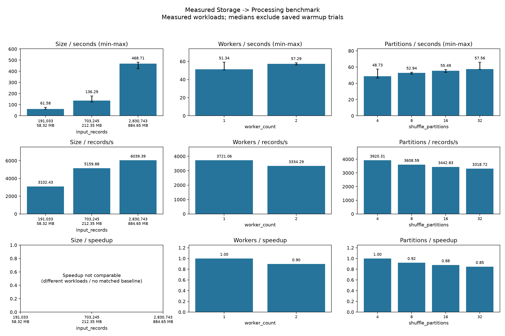

# Velocity — Đánh giá tốc độ xử lý dữ liệu bằng Apache Spark

## 1. Mục tiêu và phạm vi đánh giá

Trong đề tài “Xây dựng và đánh giá phương pháp nhận diện các hoạt động mạng bất thường từ PCAP”, thành phần Velocity được đánh giá thông qua tốc độ xử lý dữ liệu flow của hệ thống Apache Spark kết hợp MinIO. Mục tiêu thực nghiệm là xác định thời gian xử lý một lô dữ liệu, số flow xử lý được trong một giây và ảnh hưởng của kích thước dữ liệu, số worker, số shuffle partition đến hiệu năng.

Hệ thống hiện xử lý theo lô (batch processing): các file CSV đã có sẵn được lưu trên MinIO và đưa vào Spark để xử lý. Do đó, thực nghiệm đo năng lực xử lý của hệ thống đối với dữ liệu đầu vào xác định, chưa đo tốc độ dữ liệu phát sinh trên mạng hoặc độ trễ phản hồi khi có tấn công. Các kết quả cũng chưa bao gồm bước trích xuất flow từ PCAP, huấn luyện hoặc suy luận của mô hình nhận diện bất thường.

Phạm vi được đo là toàn bộ chuỗi đọc CSV từ MinIO qua S3A, tính checksum, kiểm tra và làm sạch dữ liệu, tạo đặc trưng, tổng hợp, ghi kết quả Parquet và đọc lại để xác minh. Đây là phép đo xử lý có ghi đầu ra, không chỉ chạy validation. Kết quả chính trong phần này lấy từ đợt thực nghiệm trên CSV CICIDS2017 thật ngày 10/11/2026, mã `real-20261110-141211`. Kết quả synthetic được lưu riêng để phục vụ kiểm thử và đối chiếu phương pháp [V1].

## 2. Dữ liệu và môi trường thực nghiệm

### 2.1. Dữ liệu đầu vào

Bộ dữ liệu sử dụng gồm 8 file CSV CICIDS2017, tổng cộng 2.830.743 flow, 79 cột và 884.645.759 byte, tương đương khoảng 884,65 MB theo hệ thập phân. Trước thực nghiệm, nhóm kiểm tra tên file, thứ tự header, số trường trên từng dòng và SHA-256. Cả 8 file đều khớp schema của pipeline, không phát hiện dòng sai số trường hoặc lỗi cú pháp CSV. Kiểm tra checksum sau thực nghiệm xác nhận các file nguồn không bị thay đổi [V2].

Ba mức dữ liệu được xây dựng từ các tập file nguyên gốc lồng nhau, không nhân bản bản ghi để tạo tải. Đơn vị đếm là flow trong CSV, không phải packet của PCAP.

**Bảng V.1. Các mức dữ liệu sử dụng trong thí nghiệm kích thước.**

| Mức dữ liệu | Thành phần | Số flow | Dung lượng (byte) | Dung lượng (MB) | Input partitions |
|---|---|---:|---:|---:|---:|
| Nhỏ | Friday Morning | 191.033 | 58.316.725 | 58,32 | 2 |
| Vừa | Cả 3 file Friday | 703.245 | 212.346.752 | 212,35 | 8 |
| Đầy đủ | Toàn bộ 8 CSV | 2.830.743 | 884.645.759 | 884,65 | 30 |

Khi tăng mức dữ liệu, thành phần file, phân bố nhãn và số input partitions cũng thay đổi. Vì vậy, thí nghiệm này phản ánh việc mở rộng khối lượng dữ liệu thực tế, chưa cô lập hoàn toàn tác động của riêng dung lượng đầu vào. Hai nhóm thí nghiệm worker và partition đều sử dụng cố định file Friday Morning, gồm 191.033 flow và 58.316.725 byte.

### 2.2. Cấu hình thực nghiệm

**Bảng V.2. Cấu hình phần cứng và phần mềm.**

| Thành phần | Cấu hình |
|---|---|
| CPU máy chủ | Intel Core i5-9400, 2,90 GHz, 6 cores/6 logical processors |
| RAM máy chủ | Khoảng 20 GiB |
| Hệ điều hành | Windows 10 Pro, build 19045 |
| Môi trường container | Docker Desktop, Docker Engine 29.9.3, Linux trên WSL2 |
| Tài nguyên Docker | 6 CPU; 10.406.920.192 byte RAM, khoảng 9,69 GiB |
| Apache Spark | Spark/PySpark 3.5.0 |
| Runtime trong container | Python 3.8.10; Java 11.0.20.1 |
| Lưu trữ | MinIO, đọc/ghi qua S3A; Parquet nén Snappy |
| Spark worker | 1 hoặc 2 worker; mỗi worker 2 cores và 2 GiB |
| Spark executor | 2 cores; bộ nhớ heap 2g |
| Spark driver | Heap tối đa 1 GiB |
| Cấu hình cache | DISK_ONLY; cache batch size 1000 |
| Adaptive Query Execution (AQE) | Tắt: false |

Các worker chạy trên cùng một máy vật lý và chia sẻ tài nguyên Docker. Khi tăng từ 1 lên 2 worker, tổng tài nguyên Spark được cấp cũng tăng từ 2 cores/2 GiB lên 4 cores/4 GiB; đây không phải phép so sánh giữ nguyên tổng tài nguyên. Bộ nhớ container thực tế còn bao gồm các tiến trình Python và bộ nhớ native ngoài heap executor. Thực nghiệm chưa lấy mẫu peak RAM có hệ thống, nên không dùng các quan sát tức thời để khẳng định mức RAM tối thiểu [V3].

## 3. Phương pháp đo

### 3.1. Chỉ số và phạm vi thời gian

Thời gian xử lý được xác định từ lúc bắt đầu pipeline đến khi hoàn tất xử lý, ghi và đọc lại năm dataset Parquet: flow hợp lệ, đặc trưng dẫn xuất, dữ liệu tổng hợp, dữ liệu cách ly và dữ liệu bị từ chối. Các thao tác tính checksum, kiểm tra chất lượng và hậu kiểm nằm trong phạm vi timer. Thời gian khởi tạo Spark, upload nguồn lên MinIO, xuất JSON/CSV cuối và vẽ biểu đồ nằm ngoài phạm vi đo.

Với lượt đo thứ i, throughput được tính bằng:

`Q_i = N_i / T_i`

Trong đó, `N_i` là số flow đầu vào, `T_i` là thời gian xử lý tính bằng giây và `Q_i` có đơn vị flow/s. Throughput sử dụng tổng flow đầu vào, bao gồm các flow sau đó được phân loại VALID, QUARANTINED hoặc REJECTED. Trường `Flow Packets/s` trong dữ liệu nguồn mô tả lưu lượng mạng của một flow, không phải throughput của Spark.

Thống kê cho mỗi cấu hình gồm trung vị thời gian, thời gian nhỏ nhất–lớn nhất và trung vị throughput của từng lượt đo. Tỷ số tăng tốc được tính trên cùng workload:

`Speedup = median(T_baseline) / median(T_configuration)`

Baseline là 1 worker trong thí nghiệm worker và 4 shuffle partitions trong thí nghiệm partition. Giá trị speedup lớn hơn 1 biểu thị thời gian giảm so với baseline. Không tính speedup giữa các mức size có khối lượng dữ liệu khác nhau.

### 3.2. Thiết kế thí nghiệm và kiểm soát điều kiện

Ba nhóm thí nghiệm được thực hiện như sau:

- **Kích thước dữ liệu:** giữ 2 worker và 4 shuffle partitions; lần lượt xử lý ba mức trong Bảng V.1.
- **Số worker:** giữ nguyên Friday Morning và 4 shuffle partitions; so sánh 1 với 2 worker.
- **Số partition:** giữ nguyên Friday Morning và 2 worker; thử `spark.sql.shuffle.partitions` bằng 4, 8, 16 và 32.

Mỗi cấu hình được đo 3 lần. Mỗi phiên chạy có 1 lượt làm nóng toàn pipeline, được lưu riêng và loại khỏi thống kê. Có bốn phiên chạy tương ứng size, partition, worker=1 và worker=2, tổng cộng 27 lượt tính điểm và 4 warmup. Warmup thực hiện trên cấu hình đầu của từng phiên, không phải một warmup riêng cho mọi cấu hình.

Thứ tự size và partition được đảo ở vòng lặp thứ hai để giảm thiên lệch thứ tự. Nhóm worker chạy cấu hình 1 worker trước, sau đó khôi phục worker thứ hai và đo 2 worker. Số worker ALIVE và tài nguyên app được kiểm tra qua Spark Master. Cache DataFrame được giải phóng sau mỗi lượt, nhưng cache của hệ điều hành, MinIO và JVM/JIT không được xóa; vì vậy warmup không loại hoàn toàn ảnh hưởng bộ nhớ đệm. Các phiên dùng Spark session riêng và không gộp kết quả cùng cấu hình ở các nhóm thí nghiệm khác nhau.

Các giá trị 4/8/16/32 là cấu hình shuffle partitions, không phải số partition của mọi stage. AQE được tắt để hạn chế việc tự gộp shuffle partitions. Toàn bộ lệnh thực thi, exit code và log được lưu cùng mã thực nghiệm [V4].

## 4. Kết quả thực nghiệm

### 4.1. Ảnh hưởng của kích thước dữ liệu

**Bảng V.3. Kết quả theo kích thước, giữ 2 worker và p=4; mỗi mức có 3 lần đo.**

| Số flow | Dung lượng (MB) | Trung vị (s) | Nhỏ nhất–lớn nhất (s) | Throughput trung vị (flow/s) |
|---:|---:|---:|---:|---:|
| 191.033 | 58,32 | 61,575 | 58,382–76,854 | 3.102,432 |
| 703.245 | 212,35 | 136,291 | 124,205–179,073 | 5.159,884 |
| 2.830.743 | 884,65 | 468,713 | 423,064–481,487 | 6.039,392 |

Khi số flow tăng khoảng 14,82 lần từ mức nhỏ đến mức đầy đủ, thời gian trung vị tăng khoảng 7,61 lần, còn throughput tăng khoảng 1,95 lần. Ở mức đầy đủ, hệ thống xử lý 2.830.743 flow trong khoảng 468,71 giây, tương đương 7 phút 49 giây, với throughput trung vị 6.039,39 flow/s [V5].

Kết quả phù hợp với khả năng chi phí cố định của việc lập kế hoạch, khởi tạo task và kiểm tra đầu ra chiếm tỷ trọng lớn hơn ở lô nhỏ. Đồng thời, input partitions tăng từ 2 lên 30 có thể giúp sử dụng tài nguyên tốt hơn. Đây là các khả năng giải thích, chưa phải kết luận nhân quả do thành phần dữ liệu và phân bố nhãn cũng thay đổi. Phép đo chưa chứng minh khả năng mở rộng tuyến tính hoặc hiệu năng trên dữ liệu lớn hơn phạm vi đã thử.

### 4.2. Ảnh hưởng của số worker

**Bảng V.4. Kết quả theo worker, giữ 191.033 flow/58,32 MB và p=4; mỗi cấu hình có 3 lần đo.**

| Worker | Trung vị (s) | Nhỏ nhất–lớn nhất (s) | Throughput trung vị (flow/s) | Speedup |
|---:|---:|---:|---:|---:|
| 1 | 51,338 | 50,474–59,102 | 3.721,061 | 1,000 |
| 2 | 57,293 | 56,226–58,453 | 3.334,288 | 0,896 |

Trên workload Friday Morning, tăng từ 1 lên 2 worker làm thời gian trung vị tăng khoảng 11,60%, với speedup 0,896. Như vậy, bổ sung worker chưa đem lại lợi ích về thời gian trong điều kiện thử nghiệm này.

Input Friday Morning chỉ có 2 partitions thực tế; hai worker cùng chia sẻ CPU, RAM và I/O trên một máy. Chi phí điều phối, giao tiếp, ghi/đọc và mức song song của các stage có thể hạn chế lợi ích của việc thêm worker. Tuy nhiên, thực nghiệm chưa đo riêng từng yếu tố nên chưa xác định được nguyên nhân độc lập. Kết quả này không đủ để kết luận Spark không mở rộng được hoặc một worker luôn tốt hơn hai worker trên toàn bộ 8 CSV.

### 4.3. Ảnh hưởng của shuffle partitions

**Bảng V.5. Kết quả theo partition, giữ 191.033 flow/58,32 MB và 2 worker; mỗi cấu hình có 3 lần đo.**

| Shuffle partitions | Trung vị (s) | Nhỏ nhất–lớn nhất (s) | Throughput trung vị (flow/s) | Speedup |
|---:|---:|---:|---:|---:|
| 4 | 48,729 | 46,398–57,414 | 3.920,308 | 1,000 |
| 8 | 52,938 | 51,320–53,554 | 3.608,592 | 0,920 |
| 16 | 55,487 | 53,344–56,873 | 3.442,829 | 0,878 |
| 32 | 57,562 | 57,155–65,999 | 3.318,715 | 0,847 |

Trong bốn cấu hình đã thử, p=4 có thời gian trung vị thấp nhất. Khi tăng số shuffle partitions trên workload này, thời gian trung vị tăng. Một khả năng giải thích là số task và chi phí điều phối tăng trong khi lượng dữ liệu trên mỗi partition tương đối nhỏ. Tuy nhiên, chỉ ba lần lặp và khoảng biến thiên quan sát được chưa đủ để xác lập ý nghĩa thống kê hoặc khẳng định p=4 là cấu hình tối ưu tổng quát.

Thời gian p=4 trong Bảng V.5 khác cấu hình 2 worker/p=4 ở Bảng V.4 và mức nhỏ ở Bảng V.3 vì chúng thuộc các phiên chạy khác nhau. Báo cáo giữ các nhóm độc lập, không chọn một kết quả thuận lợi từ nhóm này thay cho nhóm khác.

*Hình V.1. Tổng hợp kết quả benchmark. Các cột thể hiện trung vị; thanh sai số của biểu đồ thời gian biểu diễn nhỏ nhất–lớn nhất, không phải khoảng tin cậy. Speedup của nhóm size không được tính do khác workload.*

### 4.4. Thời gian theo công đoạn

**Bảng V.6. Trung vị thời gian từng công đoạn trên ba lượt xử lý toàn bộ 8 CSV.**

| Công đoạn | Trung vị (s) |
|---|---:|
| Đọc dữ liệu và tính SHA-256 | 89,571 |
| Chuyển đổi, validation và báo cáo chất lượng trước làm sạch | 125,108 |
| Cleaning, hậu kiểm, đối soát và báo cáo chất lượng sau làm sạch | 175,247 |
| Tạo đặc trưng và tổng hợp | 31,347 |
| Ghi Parquet và đọc lại xác minh | 51,364 |

Cleaning/hậu kiểm/đối soát là công đoạn có trung vị thời gian lớn nhất trong nhóm số đo này. Kết quả cho thấy việc bảo đảm chất lượng và tính nhất quán dữ liệu là phần đáng kể của thời gian xử lý. Các bước đọc/checksum, validation và ghi/read-back cũng đóng góp vào tổng runtime. Những số đo này chưa tách riêng thời gian CPU, shuffle, chờ I/O hoặc khởi tạo task, nên chỉ xác định công đoạn cần khảo sát thêm, chưa khẳng định bottleneck vật lý cụ thể. Trung vị của từng công đoạn không được cộng để thay thế trung vị thời gian toàn pipeline.

## 5. Kiểm chứng kết quả và khả năng tái lập

Trên cả ba lượt xử lý toàn bộ dữ liệu, pipeline đối soát:

`2.830.743 input = 2.830.628 VALID + 115 QUARANTINED + 0 REJECTED`.

Hậu kiểm đạt PASS; năm dataset Parquet được ghi với Snappy và đọc lại để xác minh. Việc phân loại VALID thể hiện đạt quy tắc chất lượng dữ liệu, không đồng nghĩa flow thuộc lớp lưu lượng bình thường. Bảng features là biểu diễn bổ sung của VALID, không cộng thêm vào số flow khi đối soát.

Audit MinIO đọc lại marker hoàn tất cùng báo cáo quality/performance của cả 31 batch, kết quả PASS, đối chiếu bằng chứng 155 output Parquet đã được pipeline đọc lại. Audit này không thay thế bằng một lần đọc mới toàn bộ 155 output. Mỗi lượt chạy có batch ID và output prefix riêng; các số đo, manifest và log được giữ để truy vết [V6].

Một đợt trước bị gián đoạn do Windows restart ngày 10/11/2026. JSON dở dang và log được giữ nguyên, không đưa vào thống kê hoàn thành. Đợt báo cáo hiện tại chạy mới sau reboot với warmup và ba lần đo mới [V7].

## 6. Giới hạn và kết luận

Thực nghiệm được thực hiện trên một máy vật lý, khối lượng lớn nhất là 884,65 MB CSV. Các phép so sánh worker và partition sử dụng workload 58,32 MB, chưa thực hiện ma trận cấu hình tương ứng trên toàn bộ 8 CSV. Dữ liệu synthetic được lưu tách khỏi dữ liệu thật và không dùng thay thế kết quả thực tế. Ảnh hưởng cache/JIT, thứ tự chạy và số lần lặp còn hạn chế độ khái quát; báo cáo chưa có phép đo peak RAM hoặc phân rã CPU/I/O đủ để kết luận nguyên nhân chậm một cách độc lập.

Trong phạm vi đã đo, hệ thống hoàn thành xử lý và kiểm chứng đầu ra cho 2.830.743 flow với thời gian trung vị 468,713 giây và throughput 6.039,392 flow/s. Throughput tăng khi mở rộng workload theo các mức đã chọn. Trên Friday Morning, tăng worker hoặc shuffle partitions chưa cải thiện thời gian trung vị. Những kết quả này cung cấp căn cứ thực nghiệm cho việc lựa chọn cấu hình và lập kế hoạch xử lý theo lô trong môi trường thử nghiệm. Khi tích hợp mô hình nhận diện, cần đo bổ sung thời gian suy luận và tốc độ toàn quy trình, đồng thời báo cáo thời gian huấn luyện riêng. Chưa có căn cứ kết luận hệ thống đáp ứng streaming hoặc cảnh báo thời gian thực.

## Tài liệu và minh chứng thực nghiệm

- **[V1]** [Hồ sơ benchmark dữ liệu thật, ngày 10/11/2026](../benchmarks/real-20261110-141211/README.md); [hồ sơ synthetic bổ trợ](../benchmarks/scaling-20261110-121252/README.md).
- **[V2]** [Danh sách file, số flow và checksum](../benchmarks/real-20261110-141211/source-files.csv); [audit nguồn](../benchmarks/real-20261110-141211/source-audit.json); [kiểm tra checksum sau benchmark](../benchmarks/real-20261110-141211/source-integrity-after.json).
- **[V3]** [Cấu hình máy](../benchmarks/real-20261110-141211/host-machine.json); [môi trường Docker và topology ban đầu](../benchmarks/real-20261110-141211/environment.json). Phiên bản runtime và tài nguyên app nằm trong JSON của từng nhóm.
- **[V4]** [Script điều phối](../benchmarks/real-20261110-141211/run_real.py); [lệnh, timestamp và exit code](../benchmarks/real-20261110-141211/execution.jsonl); raw log cùng thư mục: `size.log`, `partitions.log`, `workers-1.log`, `workers-2.log`.
- **[V5]** [Bảng tổng hợp](../benchmarks/real-20261110-141211/summary.csv); [từng lượt đo và stage timings](../benchmarks/real-20261110-141211/runs.csv); JSON gốc: [size](../benchmarks/real-20261110-141211/size.json), [partitions](../benchmarks/real-20261110-141211/partitions.json), [worker=1](../benchmarks/real-20261110-141211/workers-1.json), [worker=2](../benchmarks/real-20261110-141211/workers-2.json).
- **[V6]** [Audit MinIO](../benchmarks/real-20261110-141211/minio-audit.json); [kiểm tra tính nhất quán số đo](../benchmarks/real-20261110-141211/verification.json); [SHA-256 artifact](../benchmarks/real-20261110-141211/artifact-sha256.csv).
- **[V7]** [Ghi nhận đợt bị gián đoạn do restart](../benchmarks/real-20261110-125212/INTERRUPTED.md).
