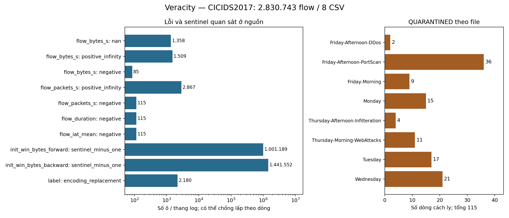

# Veracity — Đánh giá độ tin cậy và chất lượng dữ liệu

## 1. Mục tiêu và phạm vi

Trong đề tài “Xây dựng và đánh giá phương pháp nhận diện các hoạt động mạng bất thường từ PCAP”, Veracity được đánh giá qua chất lượng kỹ thuật của dữ liệu flow: cấu trúc, kiểu dữ liệu, miền giá trị, tính đầy đủ, khả năng truy vết và tính nhất quán trước/sau xử lý. Mục tiêu là phát hiện dữ liệu không phù hợp, áp dụng chính sách làm sạch có giải thích và chứng minh các bản ghi được phân loại, lưu trữ đúng quy trình.

Báo cáo sử dụng hồ sơ thực nghiệm dữ liệu thật ngày **10/11/2026**, mã `real-20261110-141211`, cùng mã pipeline trong repository. Báo cáo được tổng hợp lại từ các artifact đã lưu; lần tạo tài liệu này không chạy lại Spark, không truy cập MinIO và không sửa CSV. Số liệu theo ô lấy từ source audit; kết quả xử lý và ghi/đọc lại lấy từ các lượt Spark. Hai tầng bằng chứng được phân biệt trong từng bảng [R1–R4].

`VALID` nghĩa là đạt chính sách chất lượng hiện tại, có thể còn NULL được phép và cờ chất lượng. Trạng thái này độc lập với nhãn `BENIGN` hay nhãn tấn công; báo cáo không đo accuracy của mô hình và không xác nhận ground truth từ PCAP.

## 2. Dữ liệu, schema và tính toàn vẹn nguồn

Đầu vào gồm **8 CSV, 2.830.743 flow, 884.645.759 byte**, 79 vị trí cột. Đây là dữ liệu flow đã trích xuất, không phải 2.830.743 packet. Source audit ghi nhận cả 8 header khớp thứ tự contract, mọi dòng đủ 79 trường, không có dòng malformed hoặc lỗi giải mã UTF-8 [R1].

Header `Fwd Header Length` xuất hiện ở vị trí 35 và 56, tính từ 1. Contract ánh xạ theo vị trí thành `fwd_header_length` và `fwd_header_length_repeat_2`, tránh mất cột khi tên trùng. Audit ghi nhận 0 dòng khác giá trị giữa hai cột; pipeline vẫn giữ đủ raw evidence và không tự suy ra có thể bỏ một cột trong mọi bộ dữ liệu.

Ingestion đọc 79 trường dạng chuỗi; cleaned core chọn 22 trường gồm 6 integer, 7 long, 8 double và 1 string. Vì vậy, hậu kiểm miền giá trị của 22 trường không phải chứng nhận toàn bộ 79 trường đã được làm sạch để huấn luyện [R5].

SHA-256 từng file được lưu trong manifest và so lại khi đọc nguồn. Hồ sơ kiểm tra sau benchmark ghi nhận cả 8 file không đổi. Script tạo báo cáo kiểm tra thêm SHA-256 các artifact được dùng, schema và contract so với hồ sơ ban đầu; riêng tài liệu dạng text cho phép tái lập LF/CRLF do Git chuyển kiểu xuống dòng khi checkout, không sửa artifact. Checksum chỉ chứng minh tính nhất quán với bằng chứng lưu trữ, không xác nhận nguồn gốc tuyệt đối hoặc nhãn đúng về mặt nghiệp vụ.

## 3. Chính sách phát hiện và xử lý lỗi

Pipeline phân loại theo thứ tự ưu tiên: lỗi cấu trúc thành `REJECTED`; dòng đọc được nhưng vi phạm quy tắc cứng thành `QUARANTINED`; các dòng còn lại thành `VALID`. Lỗi mềm không tự chuyển dòng sang cách ly [R5–R6].

- **Lỗi cứng:** NULL/rỗng/cast failure ở trường bắt buộc ngoài hai rate, số âm không được phép, NaN/Infinity ở trường double ngoài rate, destination port ngoài 0–65535, TCP flag ngoài 0/1, initial window âm khác -1, label NULL/rỗng. Không sửa duration âm thành 0.
- **Lỗi mềm ở rate:** `flow_bytes_s` và `flow_packets_s` không hợp lệ được đổi NULL, kèm cờ `*_invalid` và reason code; không thay bằng 0 hay tính lại nếu chưa có chính sách tương ứng.
- **Sentinel:** initial window bằng -1 được đổi NULL và bật `init_win_fwd_missing` hoặc `init_win_bwd_missing`; không coi -1 là giá trị đo hợp lệ.
- **Nhãn có U+FFFD:** giữ nguyên chuỗi nguồn, thêm `LABEL_ENCODING_REPLACEMENT`; không đoán ký tự thay thế hoặc gộp nhãn.
- **Bản ghi trùng:** giữ nguyên vì CSV không có khóa quan sát flow ổn định để xác định trùng do lỗi sao chép. Báo cáo này không định lượng trùng và không tuyên bố dữ liệu không trùng.

**Bảng R.1. Lỗi/sentinel quan sát trong 22 trường lõi từ source audit.**

| Trường | Hiện tượng | Số ô | % flow đầu vào | Chính sách |
| --- | --- | --- | --- | --- |
| `flow_bytes_s` | NaN | 1.358 | 0,0480% | NULL + flow_bytes_s_invalid |
| `flow_bytes_s` | +Infinity | 1.509 | 0,0533% | NULL + flow_bytes_s_invalid |
| `flow_bytes_s` | Âm | 85 | 0,0030% | NULL + flow_bytes_s_invalid |
| `flow_packets_s` | +Infinity | 2.867 | 0,1013% | NULL + flow_packets_s_invalid |
| `flow_packets_s` | Âm | 115 | 0,0041% | NULL + flow_packets_s_invalid |
| `flow_duration` | Âm | 115 | 0,0041% | QUARANTINED |
| `flow_iat_mean` | Âm | 115 | 0,0041% | QUARANTINED |
| `init_win_bytes_forward` | Sentinel -1 | 1.001.189 | 35,3684% | NULL + init_win_fwd_missing |
| `init_win_bytes_backward` | Sentinel -1 | 1.441.552 | 50,9249% | NULL + init_win_bwd_missing |
| `label` | Ký tự U+FFFD | 2.180 | 0,0770% | Giữ nhãn raw + reason code |

Đơn vị là số ô theo từng trường và hiện tượng; cùng một dòng có thể xuất hiện ở nhiều hàng. Tỷ lệ là số ô của từng hàng chia tổng flow đầu vào, không phải tỷ lệ lỗi trên toàn bộ 22 × N ô. Không cộng các hàng để suy ra số dòng lỗi. Có **1.444.702 dòng VALID có ít nhất một lỗi mềm**, tương đương **51,0361%** đầu vào, theo số đếm dòng duy nhất của source audit [R1].

Audit ghi nhận 0 lỗi giải mã UTF-8 nhưng vẫn có 2.180 nhãn chứa ký tự U+FFFD: ký tự thay thế đã có trong văn bản nguồn, không đồng nghĩa thao tác đọc UTF-8 của lần audit bị lỗi.

## 4. Kết quả phân loại và bảo toàn bản ghi

**Bảng R.2. Kết quả toàn bộ 8 CSV; source policy preview khớp ba lượt Spark.**

| Trạng thái | Số flow | Tỷ lệ đầu vào |
| --- | --- | --- |
| VALID | 2.830.628 | 99,9959% |
| QUARANTINED | 115 | 0,0041% |
| REJECTED | 0 | 0,0000% |

Đối soát đạt: **2.830.743 = 2.830.628 VALID + 115 QUARANTINED + 0 REJECTED**. Tỷ lệ cách ly/từ chối chỉ là 0,0041%, không đại diện cho toàn bộ lỗi mềm. `REJECTED = 0` phản ánh cấu trúc nguồn của lần chạy này; không có nghĩa parser thiếu nhánh từ chối.

**Bảng R.3. Chi tiết theo file từ source audit [R1].**

| File CSV | Input | VALID | Cách ly | Từ chối |
| --- | --- | --- | --- | --- |
| Friday-WorkingHours-Afternoon-DDos.pcap_ISCX.csv | 225.745 | 225.743 | 2 | 0 |
| Friday-WorkingHours-Afternoon-PortScan.pcap_ISCX.csv | 286.467 | 286.431 | 36 | 0 |
| Friday-WorkingHours-Morning.pcap_ISCX.csv | 191.033 | 191.024 | 9 | 0 |
| Monday-WorkingHours.pcap_ISCX.csv | 529.918 | 529.903 | 15 | 0 |
| Thursday-WorkingHours-Afternoon-Infilteration.pcap_ISCX.csv | 288.602 | 288.598 | 4 | 0 |
| Thursday-WorkingHours-Morning-WebAttacks.pcap_ISCX.csv | 170.366 | 170.355 | 11 | 0 |
| Tuesday-WorkingHours.pcap_ISCX.csv | 445.909 | 445.892 | 17 | 0 |
| Wednesday-workingHours.pcap_ISCX.csv | 692.703 | 692.682 | 21 | 0 |

115 dòng cách ly có lỗi cứng; các giá trị âm ở `flow_duration` và `flow_iat_mean` có thể cùng thuộc một dòng, không tạo thành 230 dòng cách ly. Mọi bản ghi được giữ trong một trong ba nhóm; không cộng features hoặc aggregates vào phương trình bảo toàn vì đó là các biểu diễn dẫn xuất.



*Hình R.1. Dữ liệu nguồn đã audit; biểu đồ trái dùng trục log và đếm ô, biểu đồ phải đếm dòng. Không cộng hai loại số liệu.*

## 5. Hậu kiểm và minh chứng ghi/đọc lại

**Bảng R.4. Ba lượt Spark xử lý toàn bộ dữ liệu thật [R2–R3].**

| Lượt | Batch ID | VALID / cách ly / từ chối | Hậu kiểm | Read-back |
| --- | --- | --- | --- | --- |
| 1 | `bench-35e6e8d8087d4972be6be0773efaa37d` | 2.830.628 / 115 / 0 | PASS | 5/5 PASS |
| 2 | `bench-ea982fa0157f4120890892bad02ad86a` | 2.830.628 / 115 / 0 | PASS | 5/5 PASS |
| 3 | `bench-1acf7087275f4ebb8ad7b2bbd7303044` | 2.830.628 / 115 / 0 | PASS | 5/5 PASS |

Mỗi lượt lưu năm dataset Parquet/Snappy. Số dòng tương ứng là 2.830.628 cleaned, 2.830.628 features, 46 nhóm aggregates, 115 quarantine và 0 rejected. Dataset rejected rỗng vẫn được ghi/đọc lại. Read-back kiểm kiểu cột, số dòng và phân bố `source_file`/`label`/`quality_status` cho các output không phải aggregates [R6].

MinIO audit lịch sử đã đọc lại marker, quality JSON và performance JSON của 31 batch, ghi nhận `COMPLETE` và PASS, đồng thời đối chiếu bằng chứng 155 dataset Parquet đã được pipeline đọc lại. Số 31 gồm 27 lượt đo và 4 warmup trên nhiều mức dữ liệu; không phải 31 lượt toàn bộ 8 CSV. Audit đó không đọc mới toàn bộ 155 Parquet; script tổng hợp báo cáo hiện tại cũng chỉ kiểm tra artifact đã lưu [R3].

`quality.json` có `run_status: VERIFIED` chưa đủ xác nhận batch hoàn tất. Điều kiện hoàn thành là marker cuối `_SUCCESS.json` tại thư mục báo cáo chất lượng của đúng batch, với `run_status: COMPLETE`. Marker `_SUCCESS` của riêng một dataset Parquet không thay thế marker cuối của cả pipeline [R6].

### 5.1. Minh họa before/after có số đo Spark

Artifact `quality-example.json` thuộc **Friday Morning, 191.033 flow**, batch `bench-2881df4faa004204ba22d3e620fd800c`; đây là dữ liệu thật nhưng chỉ một file, không phải snapshot đầy đủ 8 CSV [R4].

| Chỉ số (22 trường lõi, mọi trạng thái) | Trước | Sau |
| --- | --- | --- |
| Số dòng | 191.033 | 191.033 |
| Ô NaN | 28 | 0 |
| Ô Infinity | 216 | 0 |
| Ô NULL | 0 | 214.514 |
| Ô âm không hợp lệ | 35 | 18 |
| Sentinel: raw trước / cờ sau | 214.253 | 214.253 |

Sau xử lý, NaN/Infinity rate đã thành NULL có cờ; sentinel raw được thay NULL nhưng bộ đếm sentinel sau cleaning dùng cờ đã giữ lại. Vì vậy, sentinel_count không về 0 không có nghĩa giá trị -1 còn trong cleaned output. NULL tăng có chủ đích, không phải dữ liệu tự mất thêm.

Snapshot đếm mọi trạng thái: 18 ô âm còn lại nằm trong quarantine, nên không mâu thuẫn với hậu kiểm PASS của cleaned VALID. Đối soát mẫu xác nhận multiset raw evidence được bảo toàn và không đổi trạng thái; hậu kiểm ghi nhận 0 dòng vi phạm quy tắc sau làm sạch. Không nhân các số đếm một file này để ước lượng toàn bộ dữ liệu.

## 6. Độ tin cậy của nhãn và tác động đến phân tích

**Bảng R.5. Phân bố nhãn nguồn trước xử lý [R1].**

| Nhãn raw | Số flow | Tỷ lệ |
| --- | --- | --- |
| BENIGN | 2.273.097 | 80,3004% |
| DoS Hulk | 231.073 | 8,1630% |
| PortScan | 158.930 | 5,6144% |
| DDoS | 128.027 | 4,5227% |
| DoS GoldenEye | 10.293 | 0,3636% |
| FTP-Patator | 7.938 | 0,2804% |
| SSH-Patator | 5.897 | 0,2083% |
| DoS slowloris | 5.796 | 0,2048% |
| DoS Slowhttptest | 5.499 | 0,1943% |
| Bot | 1.966 | 0,0695% |
| Web Attack � Brute Force | 1.507 | 0,0532% |
| Web Attack � XSS | 652 | 0,0230% |
| Infiltration | 36 | 0,0013% |
| Web Attack � Sql Injection | 21 | 0,0007% |
| Heartbleed | 11 | 0,0004% |

`BENIGN` chiếm 80,3004%; `Heartbleed` chỉ có 11 flow. Mất cân bằng khiến accuracy tổng thể có thể che khuất lớp hiếm; khi bổ sung mô hình cần báo cáo macro-F1, recall từng lớp và confusion matrix. Đây là định hướng đánh giá tiếp theo, chưa phải kết quả huấn luyện.

Hai trường initial window có sentinel ở 35,3684% và 50,9249% flow. Không cộng hai tỷ lệ vì có thể cùng dòng. Xóa mọi dòng chứa NULL có thể gây mất nhiều dữ liệu; báo cáo này không đo retention sau `dropna()`. Khi huấn luyện, cần giữ cờ missing/invalid, chọn chính sách impute phù hợp và fit imputer/scaler chỉ trên tập train. Việc chia tập cần xem xét file/ngày và các flow giống nhau để hạn chế leakage; không dùng metadata lineage như feature nếu chưa đánh giá rủi ro rò rỉ nhãn.

Nhãn U+FFFD vẫn được giữ để truy vết. Kiểm tra miền số, checksum và bảo toàn dòng không chứng minh nhãn mô tả đúng hành vi mạng; muốn xác minh cần bằng chứng ground truth/PCAP tương ứng ngoài phạm vi pipeline hiện tại.

## 7. Truy vết, giới hạn và kết luận

Cleaned VALID lưu 22 trường lõi cùng `source_file`, `source_dataset`, `batch_id`, `pipeline_version`, `schema_version`, `processed_at`, trạng thái, reason codes và bốn cờ chất lượng. Quarantine/rejected cùng frame annotated giữ thêm raw evidence, source path và cast-failure evidence. Cleaned VALID không giữ toàn bộ `_raw_values` hoặc `source_path`; muốn truy lại cần kết hợp file nguồn bất biến và manifest/checksum của batch. Chưa có row ID ổn định để định danh duy nhất từng flow trùng giá trị [R5–R6].

Đối soát multiset dùng raw evidence trước/sau cleaning, giữ cả số lần lặp của bản ghi. Hậu kiểm xác minh miền giá trị, cờ và phép đổi rate/window, nhãn và metadata. Read-back kiểm schema/count/distribution, chưa so toàn bộ giá trị số của từng dòng sau ghi; không coi đó là chứng minh nội dung mọi ô hoàn toàn giống nhau.

Kết quả cho thấy pipeline phân loại và kiểm chứng được 2.830.743 flow, giữ 99,9959% ở nhóm VALID, cách ly 115 dòng lỗi cứng và bảo toàn bằng chứng để giải thích lỗi. Đồng thời, 1.444.702 dòng VALID vẫn có lỗi mềm được ghi nhận. Giá trị của Veracity ở đây là chính sách xử lý minh bạch, truy vết và hậu kiểm có bằng chứng; chưa chứng nhận nhãn đúng hoặc dữ liệu sẵn sàng cho mọi mô hình.

## 8. Tái lập báo cáo và tài liệu minh chứng

Chạy từ thư mục gốc repository, cần `matplotlib`; xuất Word cần thêm `python-docx`. Không cần khởi động Spark/MinIO để tổng hợp tài liệu:

```powershell
python -m experiments.build_veracity_report --docx
```

Lệnh kiểm tra artifact/checksum và đối chiếu số liệu trước khi tạo lại Markdown, PNG và DOCX. Muốn đo lại dữ liệu nguồn hoặc chạy Spark, làm theo [hướng dẫn xử lý](../processing.md) và [benchmark](../benchmark-guide.md); đó là lần thực nghiệm mới, cần batch ID và bằng chứng mới.

- **[R1]** [Source audit 8 CSV](../benchmarks/real-20261110-141211/source-audit.json); [file/checksum](../benchmarks/real-20261110-141211/source-files.csv); [tính toàn vẹn sau benchmark](../benchmarks/real-20261110-141211/source-integrity-after.json).
- **[R2]** [Các lượt chạy size, gồm ba lượt full-data](../benchmarks/real-20261110-141211/size.json); [hồ sơ thực nghiệm](../benchmarks/real-20261110-141211/README.md).
- **[R3]** [MinIO audit lịch sử](../benchmarks/real-20261110-141211/minio-audit.json); [kiểm tra thực nghiệm](../benchmarks/real-20261110-141211/verification.json); [SHA-256 artifact](../benchmarks/real-20261110-141211/artifact-sha256.csv).
- **[R4]** [Before/after Spark cho Friday Morning](../benchmarks/real-20261110-141211/quality-example.json).
- **[R5]** [Schema](../../data/schemas/raw_flow_schema.json); [Data Contract](../../data/schemas/feature_dictionary.md); [validation](../../processing/validation.py); [cleaning](../../processing/clean.py).
- **[R6]** [Pipeline và marker cuối](../../processing/main.py); [ghi/đọc lại](../../processing/output.py); [định nghĩa quality metrics](../../processing/quality_report.py).
