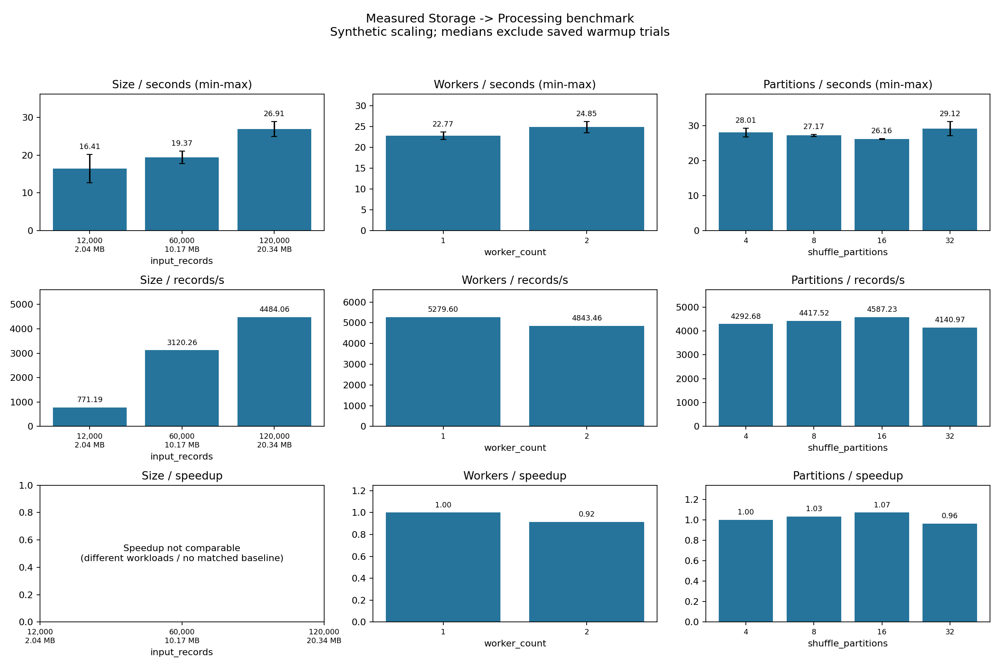

# Báo cáo triển khai Storage → Processing

Ngày tổng hợp: **21/10/2026**, múi giờ Asia/Bangkok. Phạm vi: Spark 3.5.0,
MinIO/S3A, Data Contract v2.3.0, Parquet Snappy; không ML hoặc cảnh báo.
Số đo thực nghiệm lấy từ JSON và log thực thi, không dùng số liệu minh họa.

## Các file tạo/chỉnh sửa và chức năng

Bảng bao gồm cả phần pipeline đã hoàn thiện ngày 20/10 và phần benchmark/test bổ
sung ngày 21/10. Các file cấu hình Docker, uploader, CSV gốc và Data Contract được
tái sử dụng, không chỉnh sửa trong đợt này.

| File | Chức năng |
|---|---|
| `processing/config.py` | Cấu hình qua environment; cache batch/storage level, prefix features/performance; không hardcode credentials |
| `processing/clean.py` | Tách `clean_classified_flows` để tái sử dụng phân loại; giữ trạng thái trước cleaning và API cũ |
| `processing/validation.py` | Schema/type và hậu kiểm giá trị/cờ/label; đối soát số dòng, multiset raw evidence và chuyển trạng thái |
| `processing/features.py` | Bốn feature dẫn xuất; chia an toàn, tránh overflow; aggregate theo label/source/batch |
| `processing/quality_report.py` | Đo lỗi và phân bố nhãn trước/sau; JSON/CSV từ dữ liệu thực tế |
| `processing/output.py` (mới) | Chặn output chồng nguồn, batch mới, Parquet Snappy và kiểm tra schema/count/label khi đọc lại |
| `processing/main.py` | Điều phối toàn pipeline, timing, cache, lineage; chỉ phát marker cuối khi thành công |
| `experiments/benchmark.py` (mới) | Runner chung, warmup, lặp đảo thứ tự, environment/topology/app resources, trial outputs và xử lý thất bại |
| `experiments/benchmark_size.py` | Entry point đo các input có size thực đo |
| `experiments/benchmark_workers.py` | Entry point so sánh topology hiện hành; xác minh worker ALIVE và cores app |
| `experiments/benchmark_partitions.py` | Entry point thử 4/8/16/32 shuffle partitions trên cùng input |
| `experiments/seed_scaling.py` (mới) | Nhân bản fixture synthetic trong prefix smoke riêng; manifest byte/hash; từ chối ghi đè nội dung khác |
| `experiments/plot_results.py` | CSV từng trial và median/min/max/throughput; speedup baseline tương thích; biểu đồ PNG |
| `experiments/verify_benchmark_outputs.py` (mới) | Audit chỉ đọc các marker cuối, quality/performance JSON đã lưu trên MinIO và đối chiếu benchmark |
| `tests/test_config.py` | Kiểm tra cấu hình cache và storage |
| `tests/test_post_validation.py` (mới) | Giá trị hợp lệ/sai, schema/cờ/label, mất/thay duplicate hoặc đổi trạng thái |
| `tests/test_features.py` (mới) | Công thức, mẫu số 0, Long overflow, nguồn thiếu/sai, aggregate và input rỗng |
| `tests/test_quality_report.py` (mới) | Số lỗi cell trước/sau, nhãn, phân tách file, JSON và schema |
| `tests/test_output.py` (mới) | Output batch/prefix an toàn, chống chồng lấn/raw/traversal |
| `tests/test_pipeline.py` (mới) | E2E local, no-overwrite, read-only, failure markers, count mismatch, output rỗng; kiểm tra footer Snappy |
| `tests/test_benchmark.py` (mới) | Workload grouping, loại warmup, speedup, baseline, synthetic scaling và topology mismatch |
| `tests/smoke_pipeline.py` (mới) | E2E MinIO trên fixture synthetic, xác minh 12 = 4 + 6 + 2 |
| `README.md`, `docs/processing.md` | Trạng thái thực thi và lệnh chạy pipeline |
| `docs/pipeline-validation.md` (mới) | Hồ sơ ngày 20/10: baseline tests, thử lỗi, 8 CSV read-only và smoke MinIO |
| `docs/benchmark-guide.md` (mới) | Phương pháp và lệnh tái lập cả ba benchmark |
| `docs/storage-processing-report.md` (mới) | Báo cáo bàn giao này |
| `.gitignore` | Cho phép lưu JSON/CSV benchmark nhỏ trong docs; vẫn loại raw CSV/Parquet/log/credentials |
| `docs/benchmarks/20261021/` (mới) | Manifest, môi trường, các JSON đo thực tế, CSV và biểu đồ |

## Môi trường và giới hạn phép đo

Docker Engine 29.9.2, Docker Desktop Linux x86_64, kernel WSL2
5.15.167.4-microsoft-standard-WSL2. Docker thấy 16 logical CPUs và 8.149.880.832
bytes RAM. Spark 3.5.0, Python 3.8.10, Java 11.0.20.1. Driver heap tối đa
1.073.741.824 bytes. Mỗi worker 2 cores / 2048 MiB, mỗi executor 2 cores / 2g;
Master xác nhận app dùng 2 hoặc 4 cores theo thí nghiệm. Cgroup v2 limits không đọc
được trên môi trường này (JSON ghi null); không suy chúng là unlimited.

Input/output đều MinIO qua S3A. Storage level DISK_ONLY, cache batch 1000, AQE false.
Một warmup toàn pipeline mỗi invocation, hai lần đo mỗi cấu hình. Các warmup giữ
trong JSON nhưng loại khỏi thống kê. Spark startup và xuất JSON/CSV cuối không nằm
trong timer; đọc/checksum/QA/xử lý/ghi và read-back Parquet đều có. Cache DataFrame
được giải phóng, cache OS/MinIO/JIT không flush. Không chạy unit tests đồng thời.

Đây là **synthetic scaling** từ fixture 12 dòng, có độ lặp cao. Không đánh giá chất
lượng phát hiện tấn công, không đại diện phân bố dữ liệu thật và chưa đo tải GB.
Hai workers dùng chung một máy vật lý; tăng worker đồng thời tăng tổng tài nguyên.
Chỉ hai lần đo cho mỗi cấu hình nên không coi sai khác nhỏ là có ý nghĩa thống kê.

## Input và output thực tế

| Workload synthetic | Input bytes | Input records | Cleaned / features (mỗi bảng) | Quarantined | Rejected | Aggregates |
|---|---:|---:|---:|---:|---:|---:|
| 1.000 bản fixture | 2.035.373 | 12.000 | 4.000 | 6.000 | 2.000 | 10 |
| 5.000 bản fixture | 10.171.373 | 60.000 | 20.000 | 30.000 | 10.000 | 10 |
| 10.000 bản fixture | 20.341.373 | 120.000 | 40.000 | 60.000 | 20.000 | 10 |

Features là một biểu diễn bổ sung của VALID, không cộng vào phương trình bảo toàn.
Phương trình đúng là `input = cleaned VALID + quarantine + rejected` tại từng stage.

Nguồn synthetic: `s3a://bigdata-network/smoke/benchmark-scaling/v1/copies-N/synthetic.csv`,
với N = 1000, 5000, 10000. Manifest nguồn có SHA-256 trong
[scaling-manifest.json](benchmarks/20261021/scaling-manifest.json).

Tám CSV thật đã được kiểm chứng **read-only** ngày 20/10: **2.830.743 input =
2.830.628 VALID + 115 QUARANTINED + 0 REJECTED**, tính được 2.830.628 features và
46 aggregates; hậu kiểm PASS. Đây là các bảng đã tính, chưa ghi Parquet thật lên
MinIO. Chi tiết/lỗi OOM các lần thử trước tại [pipeline-validation.md](pipeline-validation.md).

## Lệnh thực thi và tái lập

Tại root repository, đã khởi động dịch vụ bằng:

```powershell
docker compose -f docker/docker-compose.yml up -d --no-build
docker compose -f docker/docker-compose.yml exec -T spark-master python3 -m experiments.seed_scaling --manifest /tmp/scaling-20261021.json --execute
```

Các benchmark dùng `SPARK_EXECUTOR_MEMORY=2g`, `--experiment-id scaling-20261021`,
`--dataset-kind synthetic --synthetic-scaling --warmups 1 --repeats 2`,
`--master-ui http://spark-master:8080`,
`--output-prefix s3a://bigdata-network/smoke/benchmarks/20261021 --execute`.
Size truyền cả ba URI ở trên; partition/worker dùng URI copies-10000. Thứ tự chạy:
size (12k,60k,120k,120k,60k,12k), partition (4,8,16,32,32,16,8,4), rồi worker 1 và 2.
Mỗi invocation bắt đầu bằng warmup riêng không nằm trong danh sách thứ tự này.

Lệnh đầy đủ có thể chạy lại, gồm việc đổi/restoring topology và lấy artifact:
[benchmark-guide.md](benchmark-guide.md). Dùng tên result/experiment mới khi chạy lại.
Bản ghi nguyên các lệnh benchmark đã dùng: [commands.txt](benchmarks/20261021/commands.txt).

Các lệnh kiểm thử:

```powershell
python -m unittest tests.test_benchmark -v
docker compose -f docker/docker-compose.yml exec -T spark-master python3 -m unittest discover -s tests -v
python -m compileall -q processing experiments tests
git -c core.safecrlf=false diff --check
```

Lệnh biểu đồ trên host:

```powershell
python -m experiments.plot_results docs/benchmarks/20261021/size.json docs/benchmarks/20261021/partitions.json docs/benchmarks/20261021/workers-1.json docs/benchmarks/20261021/workers-2.json --csv docs/benchmarks/20261021/summary.csv --runs-csv docs/benchmarks/20261021/runs.csv --png docs/benchmarks/20261021/benchmark.png
```

## Đường dẫn đầu ra MinIO

Prefix chung của đợt đo: `s3a://bigdata-network/smoke/benchmarks/20261021`.
Mỗi trial tạo UUID batch riêng. Ví dụ trial partition 4 lần 1, batch
`bench-fb612f14128542ce908752b50444ed91`, input 120.000 records:

| Loại | Đường dẫn dưới prefix chung | Records |
|---|---|---:|
| Cleaned Parquet Snappy | `cleaned/bench-fb612f14128542ce908752b50444ed91/` | 40.000 |
| Features Parquet Snappy | `features/bench-fb612f14128542ce908752b50444ed91/` | 40.000 |
| Aggregates Parquet Snappy | `aggregates/bench-fb612f14128542ce908752b50444ed91/` | 10 |
| Quarantine Parquet Snappy | `quarantine/bench-fb612f14128542ce908752b50444ed91/` | 60.000 |
| Rejected Parquet Snappy | `rejected/bench-fb612f14128542ce908752b50444ed91/` | 20.000 |
| Quality JSON | `report/bench-fb612f14128542ce908752b50444ed91/quality.json` | — |
| Quality CSV | `report/bench-fb612f14128542ce908752b50444ed91/summary.csv` | — |
| Marker cuối | `report/bench-fb612f14128542ce908752b50444ed91/_SUCCESS.json` | — |
| Timing JSON | `performance/bench-fb612f14128542ce908752b50444ed91/performance.json` | — |

MinIO Console: `http://localhost:9001`, bucket `bigdata-network`, mở prefix tương ứng.
Không nhúng credentials vào đường dẫn. Các batch khác có đường dẫn đầy đủ trong
JSON của từng dimension và cột `quality_report_path` của CSV từng trial.
Chỉ marker JSON cuối trong report xác nhận toàn pipeline hoàn tất; `_SUCCESS` bên
trong từng output Parquet không có ý nghĩa thay thế.

Benchmark JSON bổ sung `worker_count`, `worker_resources` và `application_resources`
từ Master; JSON quality/performance do pipeline xuất vẫn có `worker_count = null`
vì API pipeline không tự suy topology. Dùng benchmark JSON khi phân tích tài nguyên.

## Kết quả benchmark thực tế

Đã hoàn thành **18 trial được tính điểm + 4 warmup**. JSON của cả bốn invocation
đều `COMPLETE`: [size](benchmarks/20261021/size.json),
[partitions](benchmarks/20261021/partitions.json),
[1 worker](benchmarks/20261021/workers-1.json),
[2 workers](benchmarks/20261021/workers-2.json).
Mỗi hàng dưới có **2 lần đo**; throughput là median của throughput từng trial,
không lấy input chia cho median duration. Speedup tính theo median duration.

| Thí nghiệm | Cấu hình | Median (s) | Min–max (s) | Throughput (records/s) | Speedup |
|---|---|---:|---|---:|---:|
| Size, 2 workers, p=4 | 12.000 records | 16,411 | 12,675–20,148 | 771,185 | N/A |
| Size, 2 workers, p=4 | 60.000 records | 19,369 | 17,722–21,016 | 3.120,259 | N/A |
| Size, 2 workers, p=4 | 120.000 records | 26,910 | 24,908–28,913 | 4.484,063 | N/A |
| Workers, 120k, p=4 | 1 worker | 22,766 | 21,843–23,690 | 5.279,599 | 1,000× |
| Workers, 120k, p=4 | 2 workers | 24,851 | 23,481–26,222 | 4.843,457 | 0,916× |
| Partitions, 120k, 2 workers | 4 | 28,011 | 26,752–29,270 | 4.292,683 | 1,000× |
| Partitions, 120k, 2 workers | 8 | 27,168 | 26,870–27,466 | 4.417,520 | 1,031× |
| Partitions, 120k, 2 workers | 16 | 26,160 | 26,078–26,241 | 4.587,230 | 1,071× |
| Partitions, 120k, 2 workers | 32 | 29,125 | 27,061–31,189 | 4.140,968 | 0,962× |

Các warmup lần lượt size/partition/1 worker/2 workers: **41,154 / 46,885 /
39,893 / 44,007 giây**; không trộn vào bảng. Input và features của workload 120k
đều có **2 partitions** thực tế; biến thí nghiệm partition là cấu hình shuffle.



Bảng tổng hợp: [summary.csv](benchmarks/20261021/summary.csv). Từng lần đo, warmup,
stage timings và URI report: [runs.csv](benchmarks/20261021/runs.csv).
Biểu đồ đã được render và kiểm tra nhãn/giá trị, thanh sai số biểu diễn min–max,
không phải confidence interval.

Nhận xét từ số đo:

- Size tăng 10 lần (12k → 120k), median time tăng khoảng 1,64 lần và throughput
  tăng khoảng 5,81 lần. Điều này phù hợp với khả năng overhead cố định chiếm tỷ lệ
  lớn ở workload nhỏ, nhưng không chứng minh scaling tuyến tính trên dữ liệu thật.
- Hai workers **không nhanh hơn** baseline một worker: thời gian cao hơn khoảng
  9,16%, speedup 0,916×. Input nhỏ/chỉ hai input partitions, overhead điều phối,
  I/O và tài nguyên Docker dùng chung là các khả năng giải thích; phép đo này
  chưa tách riêng nguyên nhân. Không kết luận Spark không scale ở workload lớn.
- 16 shuffle partitions có median thấp nhất trong bốn cấu hình đã đo, speedup
  1,071× so với 4. 32 partitions chậm hơn baseline. Hai lần đo chưa đủ để khẳng định
  16 là cấu hình tối ưu tổng quát hoặc sai khác nhỏ có ý nghĩa thống kê.
- Các invocation có JVM/session riêng; warmup giảm nhưng không loại hết cache/JIT.
  Worker 1 được đo trước worker 2; size/partition đảo thứ tự ở lần lặp thứ hai.
  Không gộp các hàng cùng cấu hình ở những dimension khác nhau để chọn kết quả đẹp.

## Quality Report và bằng chứng MinIO

Audit chỉ đọc đã tải lại **22 marker cuối + 22 quality JSON + 22 performance JSON**,
đối chiếu batch/count/hậu kiểm/schema/evidence và số đo. Kết quả **PASS**, bao phủ
**110 output Parquet** đã được Spark đọc lại trong các trial. Audit JSON không tự
chạy lại 110 lần đọc Parquet; nó xác minh các bằng chứng đã lưu từ những lần đọc đó.
Chi tiết: [minio-audit.json](benchmarks/20261021/minio-audit.json).

Bản [quality-example.json](benchmarks/20261021/quality-example.json) được lấy trực
tiếp từ batch 120k nêu trên, không tổng hợp bằng số giả:

| Chỉ số | Trước cleaning | Sau cleaning |
|---|---:|---:|
| Input / VALID / QUARANTINED / REJECTED | 120.000 / 40.000 / 60.000 / 20.000 | 120.000 / 40.000 / 60.000 / 20.000 |
| NULL cells | 20.000 | 50.000 |
| NaN cells | 10.000 | 0 |
| Infinity cells | 10.000 | 0 |
| Invalid range cells | 40.000 | 40.000 |
| Lịch sử cast error cells | 10.000 | 10.000 |

NULL tăng do quy tắc cleaning; lỗi miền còn lại được giữ trong quarantine/reject.
Cast count sau cleaning vẫn là lịch sử lỗi nguồn. Hậu kiểm PASS và không có dòng
VALID vi phạm. Đây là số đếm cell của 22 trường lõi, không phải các nhóm record rời nhau.

## Kết quả kiểm thử: PASS / FAIL / SKIPPED

| Kiểm tra | Trạng thái | Bằng chứng |
|---|---|---|
| Toàn bộ unit/integration tests trong Docker | **PASS: 36/36**, 88,041 s; 0 FAIL, 0 SKIPPED | `docs/pipeline-tests-20261021.local.log`, [test-results.json](benchmarks/20261021/test-results.json) |
| Benchmark helper tests trên host | **PASS: 7/7** | `python -m unittest tests.test_benchmark -v` |
| Hậu kiểm, features, aggregation, quality report | **PASS** | Test suite và 22 trial thực thi |
| Local E2E + output rỗng + no-overwrite + lỗi ghi/hậu kiểm | **PASS** | `tests/test_pipeline.py`; lỗi inject được kỳ vọng, không phải test FAIL |
| Snappy thực tế trong footer Parquet | **PASS** | `test_parquet_footer_confirms_snappy` |
| E2E S3A: đọc → xử lý → 5 Parquet → read-back → reports | **PASS** | 22 batch, 110 output read-back; audit marker/report PASS |
| Size / workers / partitions | **PASS thực thi**, không đồng nghĩa speedup dương | 4 JSON COMPLETE, 18 trial được tính điểm |
| Biểu đồ và CSV | **PASS** | Được sinh từ 4 JSON COMPLETE; kiểm tra hình render |
| `compileall`, `git diff --check` | **PASS** | Chạy sau thay đổi code |
| Bảo toàn 8 CSV và Data Contract | **PASS** | Uploader DRY_RUN exit 0 ngày 21/10; `docs/source-integrity-20261021.local.json`; không upload |
| Upload/ghi Parquet của 8 CSV thật lên MinIO | **SKIPPED trong đợt này** | Giữ ràng buộc chưa tự upload/ghi dữ liệu thật; read-only 8 CSV đã PASS ngày 20/10 |
| Benchmark tải GB hoặc nhiều máy vật lý | **SKIPPED** | Chưa thực nghiệm, không điền số giả |

Trong lúc bổ sung tests, lần chạy host đầu gặp `ModuleNotFoundError: pyspark` do
helper benchmark import pipeline sớm. Đã chuyển import Spark vào CLI cần Spark;
chạy lại 7 helper tests và bộ 36 test đều PASS. Các lỗi OOM và test lỗi ở đợt trước
được giữ trong [hồ sơ 20/10](pipeline-validation.md), không tuyên bố chúng đã PASS.
Log test hiện tại có ResourceWarning của socket PySpark, nhưng unittest kết thúc
`OK` và native exit code 0. Worker 2 đã được khôi phục; không xóa volume/nguồn.

## Đối chiếu Acceptance Criteria và phần còn lại

Đã có bằng chứng cho đọc MinIO, transformation/validation/cleaning theo contract,
hậu kiểm, features/aggregation, Parquet Snappy, Spark read-back, quality report,
timing, ba benchmark thực tế, test quan trọng và lệnh chạy lại. Bằng chứng lưu trữ
end-to-end trong đợt này dùng **synthetic scaling**; không thay thế bằng chứng ghi
toàn bộ CICIDS2017 thật lên MinIO.

Phần chưa thực hiện: upload/ghi output MinIO cho 8 CSV thật; benchmark trên workload
thật/tải GB và nhiều máy độc lập. Đồ án có thể sử dụng các artifact hiện tại để trình
bày pipeline và thực nghiệm đã đo, nhưng phải giữ các giới hạn trên. Không thay đổi
CSV gốc/Data Contract, không hardcode credentials, không triển khai ML hoặc cảnh báo.
